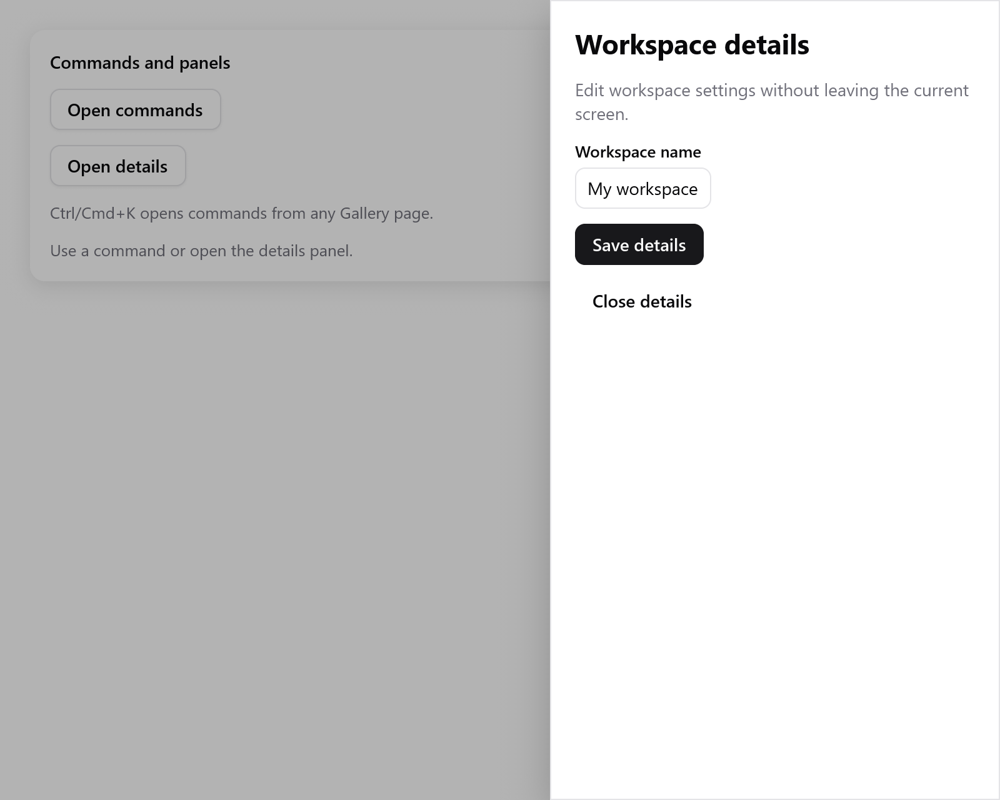

# Sheet

`ui.sheet` mở một panel modal sát một mép cửa sổ. Dùng nó cho phần chi tiết, cài đặt và bộ lọc nằm cạnh màn hình hiện tại.

<!-- demo: panels height=520 -->



```zig
// Trong state của app: details: ui.OverlayState = .{},
if (ui.button(c, "Details", .{}).clicked) s.details.show();
if (ui.sheet(c, &s.details, .{ .label = "Project details" })) |panel| {
    defer panel.end();
    ui.heading(c, "Project details");
    _ = ui.textField(c, &s.name, .{ .width = .fill, .label = "Name" });
    if (ui.button(c, "Save", .{}).clicked) {
        s.save();
        s.details.close();
    }
}
```

Giữ `OverlayState` của nó trong state của app. Panel chứa widget bình thường và tự scroll khi nội dung cao hơn chỗ hiện có.

| `SheetOptions` | Mặc định | Ý nghĩa |
|---|---|---|
| `side` | `.right` | `.left`, `.right`, `.top` hoặc `.bottom`, là mép thật của cửa sổ |
| `size` | `360` | Chiều rộng với trái/phải; chiều cao với trên/dưới, tính bằng điểm |
| `label` | `"Sheet"` | Tên của dialog modal cho trình đọc màn hình |
| `dismissible` | `true` | Bấm vào nền mờ thì đóng panel |
| `escape` | `true` | Escape đóng nó, sau khi các control con đã xử lý phím |

**Hành vi**

- Dùng chung nền mờ, cách xử lý Escape và trả lại focus của [dialog](overlays.md).
- Phần phía sau không nhận con trỏ. Tab và Shift+Tab chỉ đi trong panel.
- Kích thước bị giới hạn trong cửa sổ, kể cả sau khi đổi kích thước.
- Nội dung theo hướng chữ của app. `side` vẫn chỉ mép thật của cửa sổ.
- Khi mở, nó mờ dần vào và dịch nhẹ. Khi bật giảm chuyển động, nó hiện ra ngay.
- Khi đóng, panel biến mất và focus trở lại chỗ cũ.

Xem trang **Feedback** trong [Gallery](../../../examples/gallery/feedback.zig).
