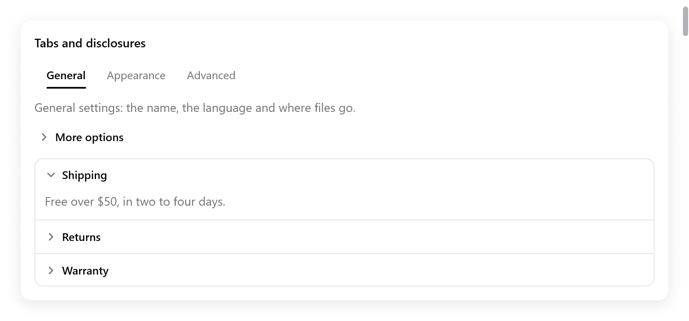
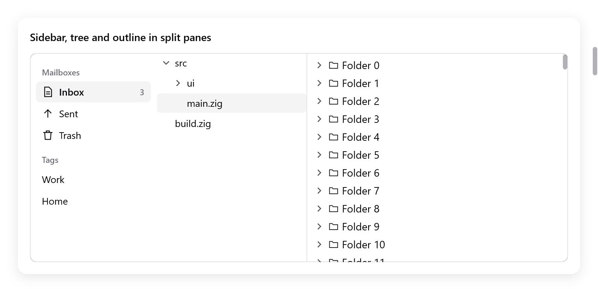
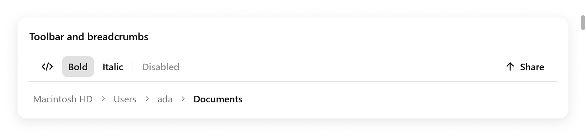

<a id="structures"></a>

# Structures

Các widget tạo nên bố cục của cửa sổ: tab, disclosure và accordion, split view, sidebar, toolbar và breadcrumb. List, tree, outline, table và grid view nằm ở trang [Lists](lists.md). Grid layout nằm ở trang [Grid](grid.md).

Chúng theo cùng một khuôn:

- Lựa chọn của chúng thuộc về app, truyền bằng con trỏ: một chỉ số, một id, một `bool`, một kích thước.
- Widget nào chứa nội dung khác thì mở một box để view lấp vào, rồi đóng bằng `end`.
- `end` của chúng, hoặc chính lời gọi, trả về những gì xảy ra trong frame này: `changed` khi một cú bấm hay phím đã đổi giá trị của app, `focused` khi chúng đang giữ focus bàn phím.

<!-- demo: structures height=397 -->



*Tab, một disclosure và một accordion với mục Shipping đang mở.*

<a id="tabs"></a>

## Tab

`ui.tabs(c, labels, &selected, opts)` là một hàng label, trong đó một label được chọn, nằm trên trang mà view dựng cho nó:

```zig
if (ui.tabs(c, &.{ "General", "Appearance", "Advanced" }, &s.tab, .{}).changed) s.save();
switch (s.tab) {
    0 => s.general(c),
    1 => s.appearance(c),
    else => s.advanced(c),
}
```

| `ui.TabsOptions` | Mặc định | |
|---|---|---|
| `width` | `.fill` | |
| `size` | 13 | cỡ chữ |

- Bấm chọn một tab và trao focus bàn phím cho thanh tab. Sau đó các phím mũi tên, Home và End cũng chọn được.
- Thanh tab chiếm một điểm dừng Tab. Shift+Tab rời nó theo chiều ngược.
- Thanh rỗng không nhận focus bàn phím và giữ nguyên lựa chọn.
- Khi có tab, lựa chọn vượt phạm vi bị kẹp về tab cuối và báo `changed`. Kể cả khi tab bị xóa bớt.
- Left và Right theo hướng layout, đảo ngược khi RTL.
- Phím có modifier để dành cho shortcut của app.

Với những trang là nơi người dùng đi tới, có lịch sử và nút back/forward, hãy dùng [router](navigation.md#the-router).

<a id="disclosures"></a>

## Disclosure

`ui.collapsible(c, title, &open)` là một header, `title` cạnh một mũi tên. Nó mở và đóng những gì view dựng bên dưới. Nội dung lớn dần khi hiện ra và thu lại khi ẩn. Dựng nội dung khi `shown` của disclosure là true (đang mở, hoặc còn đang đóng), rồi `end`:

```zig
const d = ui.collapsible(c, "More options", &s.advanced);
defer d.end();
if (d.shown) {
    _ = ui.checkbox(c, "Verbose logging", &s.verbose);
    _ = ui.checkbox(c, "Experimental features", &s.experimental);
}
```

Bấm vào header thì mở và đóng. Enter và Space cũng vậy khi header có focus bàn phím. `ui.Disclosure` còn có:

| Trường | |
|---|---|
| `changed` | header được bấm trong frame này |
| `progress` | từ 0 khi đóng tới 1 khi mở, chuyển dần theo state, cho nội dung tự animate |
| `focused`, `id` | |

<a id="accordions"></a>

## Accordion

`ui.accordion(c, opts)` là một box có viền gồm các mục xếp chồng. Mỗi mục là một disclosure mở độc lập. Thêm từng mục bằng `Accordion.item(title, &open)`, hàm này trả về `Disclosure` của mục:

```zig
var acc = ui.accordion(c, .{});
defer acc.end();
const titles = [_][]const u8{ "Shipping", "Returns", "Warranty" };
const bodies = [_][]const u8{ "Free over $50.", "Within 30 days.", "Two years." };
for (titles, bodies, 0..) |title, body, i| {
    const it = acc.item(title, &s.sections[i]);
    defer it.end();
    if (it.shown) ui.text(c, body, .{ .color = c.theme.muted });
}
```

- Up và Down chuyển focus giữa các header. Home và End chuyển tới header đầu và cuối.
- `ui.AccordionOptions` có `width` (`.fill`).
- Để mỗi lần chỉ mở một mục, hãy đóng các mục khác khi một mục mở: `if (it.changed and s.sections[i]) for (&s.sections, 0..) |*o, j| if (j != i) o.* = false;`.

<a id="split-views"></a>

## Split view

<!-- demo: tree height=415 -->



*Sidebar, cây file và outline ảo xếp trong các pane chia đôi.*

`ui.split(c, &size, opts)` đặt hai pane cạnh nhau, hoặc chồng lên nhau với `vertical`. Một thanh chia ở giữa dùng để đổi kích thước:

```zig
var sp = ui.split(c, &s.sidebar_width, .{ .min = 120 });
s.files(c);
sp.second();
s.editor(c);
if (sp.end().changed) s.saveLayout();
```

- `ui.split` mở pane thứ nhất. `second()` đóng nó, thêm thanh chia và mở pane thứ hai. `end()` đóng split và trả về kết quả.
- Con trỏ kéo thanh chia, kèm con trỏ chuột đổi kích thước. Khi thanh chia có focus, các phím mũi tên di chuyển nó.
- `size.*` là chiều rộng pane thứ nhất tính bằng điểm, hoặc chiều cao khi `vertical`.
- Với `percent`, `size.*` là phần chỗ của nó, từ 0 tới 100. Khi đó cả hai pane lớn theo cửa sổ.
- Thanh chia luôn cách mỗi mép ít nhất `min` điểm.
- Khi cửa sổ không đủ chỗ, pane thứ nhất nhường. Nó lấy lại kích thước khi có chỗ: `size.*` giữ nguyên lựa chọn của người dùng.

| `ui.SplitOptions` | Mặc định | |
|---|---|---|
| `vertical` | false | pane này nằm trên pane kia |
| `percent` | false | `size.*` là phần trăm của chỗ |
| `min` | 40 | chỗ tối thiểu mỗi pane giữ |
| `width`, `height` | `.fill` | box của split |
| `step` | 10 | khoảng mà phím mũi tên dịch thanh chia |
| `grip` | 8 | độ rộng vùng bắt con trỏ của thanh chia, theo chiều vuông góc |

Kết quả có `changed` (một cú kéo hay phím đã dịch thanh chia), `dragging` và `focused`. Split lồng được: một pane có thể chứa split khác.

<a id="sidebars"></a>

## Sidebar

`ui.sidebar(c, &selected, opts)` là một source list như của Finder và Mail. Nó hiện các mục có icon chia theo nhóm, và ghi id của mục được chọn vào `selected.*`, một `[]const u8` do app giữ. Thêm nhóm và mục, rồi `end`:

```zig
var sb = ui.sidebar(c, &s.mailbox, .{ .width = .{ .px = 170 } });
if (sb.section("Mailboxes", &s.mailboxes_shown)) {
    sb.item("inbox", "Inbox", .{ .icon = "doc.text", .badge = "3" });
    sb.item("sent", "Sent", .{ .icon = "arrow.up" });
    sb.item("trash", "Trash", .{ .icon = "trash" });
}
if (sb.section("Tags", null)) {
    sb.item("work", "Work", .{});
    sb.item("home", "Home", .{});
}
if (sb.end().changed) s.showMailbox();
```

- `section(title, open)` thêm tiêu đề nhóm. Bấm vào nó để ẩn hiện các mục. Nó trả về các mục có đang hiện không: luôn hiện khi `open` là null.
- `item(id, label, opts)` thêm một mục chọn `id`. App giữ id đó trong khi mục còn hiện.
- `ui.SidebarItemOptions` có `icon` (một SF Symbol, hoặc icon nét của myzig ngoài macOS) và `badge` (một con số hay một từ ở cuối hàng).
- Sidebar scroll khi không đủ chỗ cho các mục.
- Bấm để chọn một mục. Khi sidebar có focus, Up, Down, Home, End và các chữ cái đầu của label sẽ chọn giữa các mục.
- Mục được chọn hiện bằng màu accent khi sidebar có focus, màu xám khi không, như của AppKit.

| `ui.SidebarOptions` | Mặc định |
|---|---|
| `width` | `.{ .px = 220 }` |
| `height` | `.fill` |
| `background` | null: màu của theme |

<a id="toolbars"></a>

## Toolbar

<!-- demo: toolbar height=210 -->



*Các action của toolbar và một breadcrumb.*

`ui.toolbar(c, opts)` là một hàng control dọc cạnh trên của cửa sổ hoặc pane. Các control không có nền riêng cho tới khi được hover.

```zig
var tb = ui.toolbar(c, .{});
_ = tb.button("", .{ .icon = "chevron.left.forwardslash.chevron.right" });
_ = tb.toggle("Bold", &s.bold);
_ = tb.toggle("Italic", &s.italic);
tb.separator();
_ = tb.button("Disabled", .{ .disabled = true });
tb.spacer();
if (tb.button("Share", .{ .icon = "arrow.up" })) s.share();
tb.end();
```

- `button(title, opts)` là true khi được bấm, bằng chuột hoặc phím. Tùy chọn của nó là `icon` và `disabled`. Icon đứng trước title, hoặc đứng một mình khi title rỗng.
- `toggle(title, &value)` giữ trạng thái nhấn khi `value.*` là true. Nó là true trong frame được bật tắt.
- `toggleIcon(title, icon, &value)` hiện một icon, title dành cho công nghệ hỗ trợ.
- `spacer()` đẩy các control phía sau về cuối.
- `separator()` vẽ một đường dọc mảnh giữa các nhóm.

Toolbar là một điểm dừng bàn phím, như [focus group](navigation.md#focus-groups) với các control khác:

- Bấm vào một control sẽ trao focus cho nó.
- Sau đó Left và Right di chuyển giữa các control. Home và End tới control đầu và cuối.
- Enter hoặc Space bấm control đang hiện focus.

| `ui.ToolbarOptions` | Mặc định | |
|---|---|---|
| `width` | `.fill` | |
| `height` | 40 | |
| `border` | true | một đường kẻ bên dưới |

Trong cửa sổ ẩn title bar, hãy đặt `c.title_bar_height` bằng chiều cao toolbar. Khi đó kéo chỗ trống của toolbar sẽ di chuyển cửa sổ (xem [Windows](../windows.md)).

<a id="breadcrumbs"></a>

## Breadcrumb

`ui.breadcrumbs(c, items, &chosen, opts)` hiện một đường dẫn gồm các địa điểm. Mỗi địa điểm là một link, trừ cái cuối, là nơi người dùng đang đứng. Nó trả về true trong frame một link được chọn, kèm chỉ số trong `chosen.*`:

```zig
const path = [_][]const u8{ "Macintosh HD", "Users", "ada", "Documents" };
if (ui.breadcrumbs(c, &path, &s.crumb, .{})) s.goUp(s.crumb);
```

`ui.BreadcrumbsOptions` có `size` (13) và `max_item_width` (200). Mục dài hơn bị cắt bớt.
