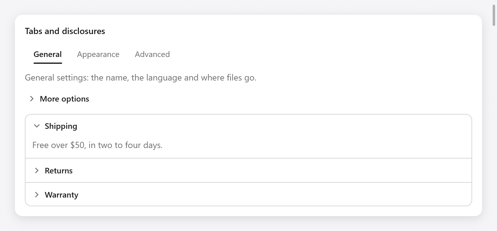
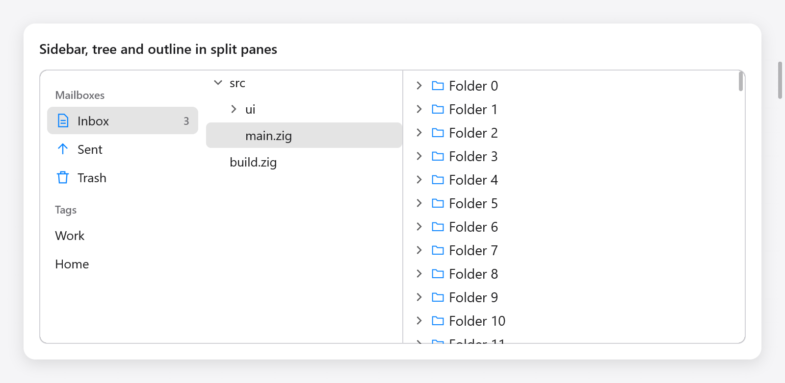
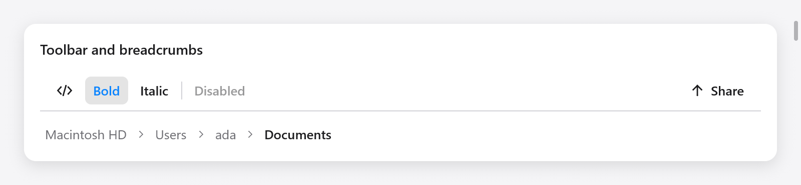

<a id="structures"></a>

# Cấu trúc

Các widget tạo hình dạng cho cửa sổ: tab, tiết lộ và xếp chồng, view phân chia, thanh bên, thanh công cụ và đường dẫn. Danh sách, cây, đường viền, bảng và view lưới đều có trên [Danh sách](lists.md); bố cục lưới nằm trên [Grid](grid.md).

Các widget này tuân theo một mẫu: lựa chọn mà chúng đưa ra là của ứng dụng (chỉ mục, id, `bool`, kích thước), được chuyển qua con trỏ và những widget chứa nội dung khác sẽ mở một hộp mà view lấp đầy, sau đó đóng lại bằng `end`. `end` (hoặc chính cuộc gọi) của họ trả về những gì đã xảy ra trong khung này: `changed` khi một cú nhấp chuột hoặc một phím thay đổi giá trị của ứng dụng và `focused` khi họ tập trung vào bàn phím.

<a id="tabs"></a>



*Tab, mục thu gọn và accordion với phần Shipping đang mở.*

## Tab

`ui.tabs(c, labels, &selected, opts)` là một hàng nhãn trong đó một nhãn được chọn, trên trang mà view xây dựng cho nó:

```zig
if (ui.tabs(c, &.{ "General", "Appearance", "Advanced" }, &s.tab, .{}).changed) s.save();
switch (s.tab) {
    0 => s.general(c),
    1 => s.appearance(c),
    else => s.advanced(c),
}
```

Một cú nhấp chuột sẽ chọn một tab, cũng như các mũi tên, Home và End trong khi thanh tab có tiêu điểm bàn phím mà một cú nhấp chuột mang lại cho nó. `ui.TabsOptions` có `width` (`.fill`) và `size` (13, cỡ chữ).

Đối với các trang là nơi người dùng truy cập, có lịch sử và chuyển tiếp qua lại, hãy sử dụng [bộ định tuyến](navigation.md#the-router).

<a id="disclosures"></a>

## Tiết lộ

`ui.collapsible(c, title, &open)` là một tiêu đề, `title` bên cạnh một mũi tên, mở và đóng những gì view xây dựng bên dưới nó. Nội dung phát triển thành tầm nhìn và thu nhỏ lại; xây dựng nó trong khi `shown` của công bố là true (mở hoặc vẫn đóng), sau đó `end`:

```zig
const d = ui.collapsible(c, "More options", &s.advanced);
defer d.end();
if (d.shown) {
    _ = ui.checkbox(c, "Verbose logging", &s.verbose);
    _ = ui.checkbox(c, "Experimental features", &s.experimental);
}
```

Một cú nhấp chuột vào tiêu đề sẽ mở và đóng nó, cũng như Enter và Space trong khi nó có tiêu điểm bàn phím. `ui.Disclosure` cũng có `changed` (tiêu đề được nhấn trong khung này), `progress` (từ 0 đóng thành 1 mở, giảm dần về trạng thái, đối với nội dung tự động), `focused` và `id`.

<a id="accordions"></a>

## Đàn accordion

`ui.accordion(c, opts)` là một hộp có viền bao gồm các phần chồng lên nhau, mỗi phần đều có phần tiết lộ riêng. Thêm mỗi cái bằng `Accordion.item(title, &open)`, trả về `Disclosure` của nó:

```zig
var acc = ui.accordion(c, .{});
defer acc.end();
const titles = [_][]const u8{ "Shipping", "Returns", "Warranty" };
const bodies = [_][]const u8{ "Free over $50.", "Within 30 days.", "Two years." };
for (titles, bodies, 0..) |title, body, i| {
    const it = acc.item(title, &s.sections[i]);
    defer it.end();
    if (it.shown) ui.text(c, body, .{ .color = c.theme.muted });
}
```

Up và Down di chuyển tiêu điểm giữa các tiêu đề, Home và End đến đầu tiên và cuối cùng. `ui.AccordionOptions` có `width` (`.fill`). Đối với accordion có một phần được mở mỗi lần, hãy đóng các phần khác khi một phần mở ra: `if (it.changed and s.sections[i]) for (&s.sections, 0..) |*o, j| if (j != i) o.* = false;`.

<a id="split-views"></a>

## Chia lượt xem



*Thanh bên, cây tệp và outline ảo được bố trí trong các khung chia đôi.*

`ui.split(c, &size, opts)` đặt hai ngăn cạnh nhau (hoặc một ngăn ở trên ngăn kia, `vertical`), với một dải phân cách giữa chúng mà con trỏ kéo để định cỡ lại chúng (hiển thị con trỏ đổi kích thước) hoặc các mũi tên di chuyển khi nó có tiêu điểm. Nó mở khung đầu tiên; `second()` đóng nó lại, thêm dải phân cách và mở dải phân cách thứ hai; `end()` đóng phần tách và trả về kết quả:

```zig
var sp = ui.split(c, &s.sidebar_width, .{ .min = 120 });
s.files(c);
sp.second();
s.editor(c);
if (sp.end().changed) s.saveLayout();
```

`size.*` là chiều rộng của khung đầu tiên (chiều cao của nó khi `vertical`) tính theo điểm, hoặc với `percent`, tỷ lệ của khung này trong phòng từ 0 đến 100, vì vậy cả hai khung đều phát triển cùng với cửa sổ. Dải phân cách giữ `min` điểm từ một trong hai cạnh; khi cửa sổ còn ít chỗ trống hơn, khung đầu tiên sẽ nhường chỗ và lấy lại kích thước của nó khi có lại chỗ trống: `size.*` giữ nguyên những gì người dùng đã chọn.

`ui.SplitOptions`:

| trường | Mặc định | |
|---|---|---|
| `vertical` | false | một khung ở trên khung kia |
| `percent` | false | `size.*` là phần trăm của phòng |
| `min` | 40 | ngăn ít nhất mà một trong hai ngăn giữ được |
| `width`, `height` | `.fill` | hộp chia |
| `step` | 10 | mũi tên di chuyển dải phân cách bao xa |
| `grip` | 8 | độ rộng của dải phân cách đối với con trỏ, trên đường thẳng của nó |

Kết quả có `changed` (một cú kéo hoặc một phím đã di chuyển dải phân cách), `dragging` và `focused`. Tổ chia tách: một khung có thể chứa một phần chia khác.

<a id="sidebars"></a>

## Thanh bên

`ui.sidebar(c, &selected, opts)` là danh sách nguồn dưới dạng Finder và Mail: các mục có biểu tượng trong các phần, chọn id của một mục vào `selected.*` (a `[]const u8` ứng dụng sẽ giữ lại). Thêm các phần và mục, sau đó `end`:

```zig
var sb = ui.sidebar(c, &s.mailbox, .{ .width = .{ .px = 170 } });
if (sb.section("Mailboxes", &s.mailboxes_shown)) {
    sb.item("inbox", "Inbox", .{ .icon = "doc.text", .badge = "3" });
    sb.item("sent", "Sent", .{ .icon = "arrow.up" });
    sb.item("trash", "Trash", .{ .icon = "trash" });
}
if (sb.section("Tags", null)) {
    sb.item("work", "Work", .{});
    sb.item("home", "Home", .{});
}
if (sb.end().changed) s.showMailbox();
```

`section(title, open)` thêm tiêu đề phần, nhấp chuột vào đó sẽ ẩn và hiển thị các mục của nó; nó trả về liệu chúng có hiển thị hay không (luôn luôn, đối với null `open`). `item(id, label, opts)` thêm một mục chọn `id`, ứng dụng sẽ giữ lại mục này trong khi hiển thị; `ui.SidebarItemOptions` có `icon` (Biểu tượng SF hoặc biểu tượng dòng của myzig tắt macOS) và `badge` (số đếm hoặc một từ ở cuối hàng). Nó cuộn khi các mục của nó không vừa.

Một cú nhấp chuột sẽ chọn một mục; trong khi thanh bên có tiêu điểm, Lên, Xuống, Trang chủ, Kết thúc và các chữ cái đầu tiên trong nhãn của mục sẽ chọn trong số đó. Mục được chọn hiển thị bằng màu nhấn trong khi thanh bên có tiêu điểm, nếu không thì có màu xám, giống như AppKit. `ui.SidebarOptions` có `width` (`.{ .px = 220 }`), `height` (`.fill`) và `background` (null: chủ đề).

<a id="toolbars"></a>

## Thanh công cụ



*Các thao tác trên thanh công cụ và đường dẫn breadcrumb.*

`ui.toolbar(c, opts)` là một hàng điều khiển dọc theo đầu cửa sổ hoặc khung, không có mặt nào cho đến khi được di chuột. Thanh công cụ là một điểm dừng của bàn phím: thao tác bấm vào một điều khiển sẽ đặt tiêu điểm cho nó, Trái và Phải rồi di chuyển giữa các điều khiển của nó, Home và End đến đầu tiên và cuối cùng, đồng thời Enter hoặc Space nhấn vào điều khiển được hiển thị (như [nhóm tiêu điểm](navigation.md#focus-groups) thực hiện đối với các điều khiển khác):

```zig
var tb = ui.toolbar(c, .{});
_ = tb.button("", .{ .icon = "chevron.left.forwardslash.chevron.right" });
_ = tb.toggle("Bold", &s.bold);
_ = tb.toggle("Italic", &s.italic);
tb.separator();
_ = tb.button("Disabled", .{ .disabled = true });
tb.spacer();
if (tb.button("Share", .{ .icon = "arrow.up" })) s.share();
tb.end();
```

- `button(title, opts)` là true khi được nhấp vào (hoặc nhấn bằng phím); các tùy chọn của nó là `icon`, trước tiêu đề hoặc một mình khi tiêu đề trống và `disabled`.
- `toggle(title, &value)` vẫn ngừng hoạt động trong khi `value.*` là true và là true trong khung mà nó chuyển đổi; `toggleIcon(title, icon, &value)` hiển thị một biểu tượng có tiêu đề dành cho công nghệ hỗ trợ.
- `spacer()` đẩy các nút điều khiển sau nó đến hết; `separator()` vẽ một đường thẳng đứng mỏng giữa các nhóm.

`ui.ToolbarOptions` có `width` (`.fill`), `height` (40) và `border` (một dòng bên dưới nó, true). Trong cửa sổ có thanh tiêu đề bị ẩn, hãy đặt `c.title_bar_height` chiều cao của thanh công cụ để việc kéo căn phòng trống của nó sẽ di chuyển cửa sổ (xem [Cửa sổ](../windows.md)).

<a id="breadcrumbs"></a>

## Vụn bánh mì

`ui.breadcrumbs(c, items, &chosen, opts)` hiển thị đường dẫn của các địa điểm, mỗi địa điểm là một liên kết nhưng cuối cùng là vị trí của người dùng. Nó trả về true trong khung mà một liên kết đã được chọn, chỉ mục của nó trong `chosen.*`:

```zig
const path = [_][]const u8{ "Macintosh HD", "Users", "ada", "Documents" };
if (ui.breadcrumbs(c, &path, &s.crumb, .{})) s.goUp(s.crumb);
```

`ui.BreadcrumbsOptions` có `size` (13) và `max_item_width` (200): các mục dài hơn sẽ bị cắt bớt.
