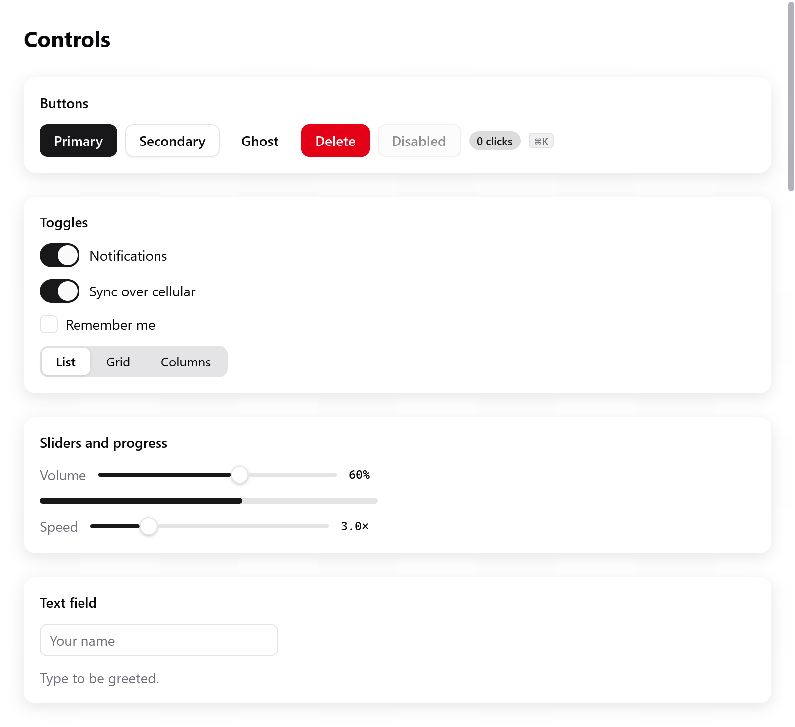
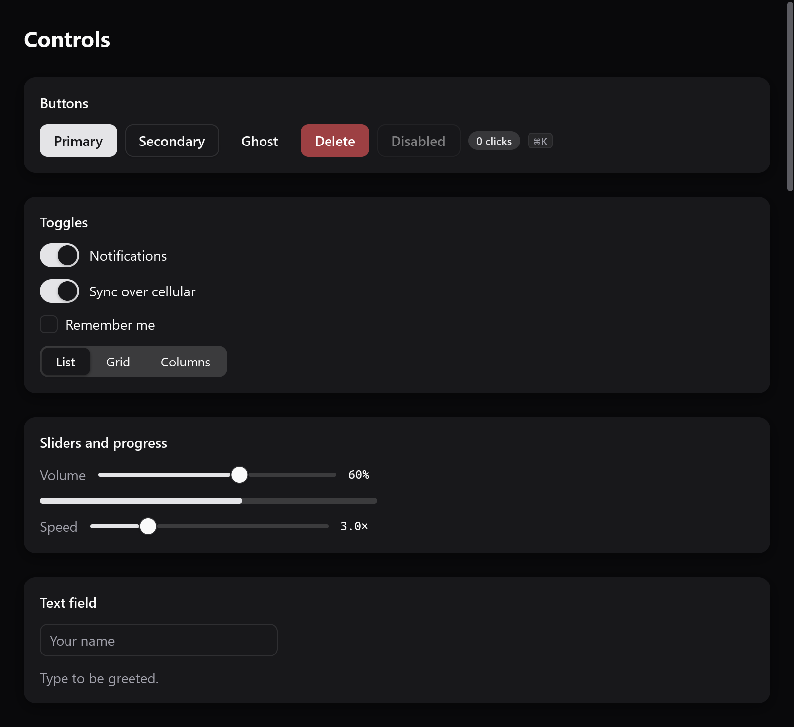

<a id="styling-and-themes"></a>

# Style và theme

Vẻ ngoài của một box là một phần của `ui.Style`, nằm cạnh layout của nó: nền, viền, góc bo, bóng, độ mờ. Widget lấy màu từ theme của frame, `c.theme`. Theme này theo giao diện sáng hoặc tối của hệ thống, trừ khi app cố định nó.



*Các control trong Gallery với theme sáng.*



*Cùng các control đó với theme tối.*

```zig
ui.column(c, .{
    .padding = .all(16),
    .gap = 8,
    .background = c.theme.surface,
    .border = c.theme.border,
    .radius = 12,
    .shadow = .{ .color = c.theme.shadow, .blur = 16, .y = 4 },
});
defer ui.end(c);
```

<a id="the-look-of-a-box"></a>

## Vẻ ngoài của một box

| trường | vẽ gì |
|---|---|
| `background: ?Color` | màu nền, bên trong các góc bo |
| `border: ?Color`, `border_width` (1) | viền nằm bên trong mép box |
| `radius` | bán kính góc, tính bằng điểm; `1e4` (`roundedFull()`) tạo hình viên thuốc hoặc hình tròn |
| `corners` | cách góc cong: `.circular` (như CSS), hoặc `.continuous` (`continuous()`), như macOS và iOS bo góc |
| `shadow: ?Shadow` | bóng Gaussian: `color`, `blur` (độ lệch chuẩn, mặc định 12) và `y` (độ đổ xuống, 4) |
| `opacity` | độ trong suốt của box cùng nội dung, từ 0 tới 1 |
| `gradient: ?*const Gradient` | màu tuyến tính, tỏa tròn hoặc hình nón phủ lên nền |
| `blur` | làm mờ box và các phần tử con khi vẽ (như `filter: blur()` của CSS) |
| `effect: ?*const Effect` | vẽ box từ những gì nằm bên dưới nó (kính mờ) |

```zig
ui.card(c, .{ .radius = 18, .corners = .continuous, .shadow = .{ .blur = 18, .y = 6 } });
const tile = ui.div(c).w(64).h(64).rounded(14).continuous().bg(th.accent);
```

**Góc liên tục** là kiểu "squircle": đường cong góc liên tục của Core Animation và hình chữ nhật bo góc của SwiftUI. Nhờ đó card hay nút trông giống của hệ thống.

- Cạnh bắt đầu cong từ xa góc hơn, khoảng 1,53 lần bán kính, và uốn dần dần.
- Chúng định hình nền và viền của box, bóng, ảnh (`corners` của `ui.image`), gradient và vùng bị cắt.
- Mọi renderer vẽ chúng giống hệt nhau, cả CPU lẫn GPU.
- Hiệu ứng backdrop vẫn giữ góc tròn thường.

Gradient, blur, hiệu ứng backdrop và transform có trang riêng: [transform và hiệu ứng](transforms.md). Gradient được giữ cho tới khi frame được vẽ. Hãy truyền một hằng số, bộ nhớ của app, hoặc bộ nhớ của frame (`c.alloc().create(ui.Gradient)`).

<a id="colors"></a>

## Màu

`ui.Color` là sRGB với alpha thẳng, mỗi kênh từ 0 tới 1:

```zig
const blue: ui.Color = .hex(0x0a84ff);
const faint = blue.alpha(0.15);                 // nhân với độ đục của nó
const between = c.theme.surface.mix(blue, 0.3); // đi được 30% quãng đường tới màu xanh
const ink: ui.Color = .{ .r = 0.1, .g = 0.1, .b = 0.12 };
```

`ui.Color.white`, `.black` và `.transparent` là hằng số.

```zig
const accent = ui.oklch(0.62, 0.19, 255);
const hover = ui.oklch(0.55, 0.19, 255);
```

Để làm bảng màu, `ui.oklch(l, c, h)` tạo một màu trong không gian Oklch, như `oklch()` của CSS:

- `l`: độ sáng từ 0 tới 1. `c`: độ bão hòa từ khoảng 0 tới 0,4. `h`: sắc độ tính bằng độ.
- Các màu cùng độ sáng trông sáng như nhau. Bảng màu gồm nhiều sắc độ ở cùng độ sáng và độ bão hòa sẽ đều nhau, và màu hover của accent là cùng sắc độ nhưng tối hơn một chút.
- Màu mà sRGB không hiển thị được sẽ giảm độ bão hòa, giữ nguyên độ sáng và sắc độ.
- `ui.toOklch(color)` chuyển ngược lại, trả về `[3]f32`.

<a id="state-not-selectors"></a>

## State, không phải selector

```zig
const i = c.open(.{ .padding = .xy(12, 6), .radius = 6 }, null);
defer c.end();
const it = c.interact(i, .{});
const t = c.animate(it.id, 0, if (it.hovered) 1 else 0, 18);
c.node(i).style.background = c.theme.surface.mix(c.theme.surface_hover, t);
```

Không có selector và không có pseudo-class. View biết state, và đặt style cho box dựa trên state đó.

- Hover, bấm và focus đến từ tương tác của box.
- `c.animate` đưa dần một giá trị về đích, nên vẻ ngoài thay đổi có animation chứ không đột ngột.
- `ui.div(...).hover(color)` làm việc này cho màu nền.
- Hover đi theo tổ tiên, như `:hover` của CSS. Một dòng được coi là đang hover khi con trỏ nằm trên một nút bên trong nó. Nhờ vậy dòng chỉ hiện nút khi hover vẫn giữ các nút đó khi con trỏ di tới chúng.

Xem [widget tùy biến](custom-widgets.md) về tương tác và [chuyển động](motion.md) về spring, keyframe và transition.

<a id="the-theme"></a>

## Theme

`ui.Theme` chứa các màu mà mọi widget dùng, và các font:

| trường | dùng cho |
|---|---|
| `dark` | đây có phải theme tối không |
| `background` | cửa sổ |
| `surface`, `surface_hover` | card, ô nhập, nút phụ; trạng thái hover của chúng, và mục được chọn trong list, menu và table |
| `text`, `muted` | chữ, và chữ phụ (label, placeholder) |
| `border` | viền, đường phân cách |
| `accent`, `accent_hover`, `accent_text` | nút chính, switch đang bật, vùng chọn chữ, và chữ nằm trên màu accent |
| `ring` | viền và quầng sáng của thứ đang có focus bàn phím |
| `track`, `knob` | rãnh và núm của slider, switch và thanh tiến trình |
| `danger`, `success`, `warning` | thao tác phá hủy và lỗi; đã xong; thứ cần chú ý |
| `shadow` | màu của bóng |
| `font`, `mono_font` | họ font, null để dùng font hệ thống ([chữ](text.md)) |
| `tooltip_delay` | số giây con trỏ đứng yên trước khi tooltip hiện; 0 nghĩa là 0,6, số âm là hiện ngay ([overlay](overlays.md#tooltips)) |

`ui.Theme.light` và `ui.Theme.dark_theme` là theme của myzig: [bảng màu](#palettes) zinc. Cửa sổ dùng cái này hay cái kia theo giao diện của hệ thống, và tự đổi khi hệ thống đổi. Để cố định màu của một cửa sổ, hãy cho nó một theme:

```zig
var mine = ui.Theme.dark_theme;
mine.accent = .hex(0xff9f0a);
mine.font = "Inter";
_ = try app.newWindow(.{ .title = "Player", .theme = mine, .content = .{ .view = .init(&state, State.view) } });
```

- Trong view, `ui.themes.apply(c, theme)` đặt một theme làm theme của frame. Các widget dựng sau lệnh này đọc theme đó, nền cửa sổ cũng vậy. Hãy gọi nó đầu tiên.
- `myzig.isDark()` và `myzig.accentColor()` đọc giao diện và màu accent của hệ thống từ bên ngoài view.

<a id="palettes"></a>

## Bảng màu

<!-- demo: palettes height=230 -->


`ui.Palette` là một trong các theme của [shadcn/ui](https://ui.shadcn.com): một nền xám có màu chính riêng, hoặc lấy một trong các accent làm màu chính.

| | |
|---|---|
| `base` | `neutral`, `stone`, `zinc` (mặc định), `mauve`, `olive`, `mist`, `taupe` |
| `accent` | `amber`, `blue`, `cyan`, `emerald`, `fuchsia`, `green`, `indigo`, `lime`, `orange`, `pink`, `purple`, `red`, `rose`, `sky`, `teal`, `violet`, `yellow`; null để dùng màu riêng của nền |

```zig
fn view(s: *State, c: *ui.Context) void {
    ui.themes.use(c, .{ .base = .stone, .accent = .blue });
    // ...
}
```

`ui.themes.use` đặt một bảng màu làm theme của frame, sáng hoặc tối theo cửa sổ. Hãy gọi nó đầu tiên trong view.

```zig
_ = try app.newWindow(.{ .theme = ui.Palette.theme(.{ .accent = .rose }, true), .content = .{ .view = .init(&state, State.view) } });
```

`palette.theme(dark)` chính là `ui.Theme`. Dùng nó để cố định cửa sổ ở một giao diện, hoặc để chuyển sang theme đó có animation.

Với chữ hay icon mang màu accent, hãy dùng `theme.accentInk()`, không dùng `theme.accent`. Màu chính có sắc thường tối khi ở theme tối, còn màu vàng lại sáng khi ở theme sáng. `accentInk()` kéo màu về gần màu chữ trong những trường hợp đó, để đọc được.

<a id="named-themes"></a>

## Theme có tên

`ui.themes.builtins` liệt kê các theme của myzig theo tên: `light`, `dark`, `light-high-contrast` và `dark-high-contrast`.

Với theme được lưu trong cài đặt theo tên, `ui.themes.find(list, name)` tìm tên đó:

1. trong danh sách riêng của app;
2. trong danh sách của myzig;
3. trong các bảng màu (`stone-light`, `blue-dark`, `stone-blue-dark`).

```zig
const app_themes = [_]ui.themes.Named{
    .{ .name = "solarized", .theme = solarized },
};

fn view(s: *State, c: *ui.Context) void {
    if (ui.themes.find(&app_themes, s.theme_name)) |t| ui.themes.apply(c, t);
    // ...
}
```

| hàm | |
|---|---|
| `ui.themes.forAppearance(dark, light_theme, dark_theme)` | chọn theme sáng hoặc tối trong một cặp |
| `ui.themes.withAccent(theme, color)` | đổi accent của theme, kèm màu hover, và chữ đen trên accent khi chữ trắng không nổi bật, như trên nền vàng |
| `ui.themes.mix(a, b, t)` | trộn mọi màu của hai theme |

<a id="switching-themes-animated"></a>

## Đổi theme có animation

`ui.ThemeSwitcher` (`ui.themes.Switcher`) chuyển từ theme này sang theme khác, mọi màu đều đổi dần, giống hệ thống khi đổi giao diện. Giữ nó trong state, đổi bằng `switchTo`, và `apply` nó đầu tiên trong view:

```zig
const State = struct {
    dark: bool = false,
    theme: ui.ThemeSwitcher = .{},

    fn view(s: *State, c: *ui.Context) void {
        s.theme.apply(c);
        ui.column(c, .{ .padding = .all(20), .gap = 12 });
        defer ui.end(c);
        if (ui.toggle(c, "Dark", &s.dark))
            s.theme.switchTo(if (s.dark) ui.Theme.dark_theme else ui.Theme.light);
    }
};
```

- Trước lần `switchTo` đầu tiên, theme riêng của cửa sổ được hiển thị.
- `duration` mặc định là 0,3 giây.
- `changing()` cho biết có đang chuyển hay không. `current()` là theme đang hiển thị.
- Màu đổi không làm gì di chuyển, nên theme vẫn đổi mượt kể cả khi người dùng yêu cầu giảm chuyển động.

<a id="the-desktop-s-preferences"></a>

## Tùy chọn của desktop

`ui.preferences.apply(c)`, gọi đầu tiên trong view, làm frame theo cài đặt của người dùng. Nó trả về các cài đặt đó dưới dạng `ui.Preferences`:

| trường | lấy từ |
|---|---|
| `accent` | màu accent người dùng chọn, null nếu desktop không có |
| `high_contrast` | Increase contrast của macOS, contrast theme của Windows, theme tương phản cao của GTK |
| `text_scale` | cỡ chữ của Windows, độ phân giải font của GTK, 1 là bình thường |
| `reduce_motion` | cài đặt giảm chuyển động của hệ thống (xem [chuyển động](motion.md)) |

- Theme nhận màu accent.
- Khi bật tương phản cao, viền và chữ phụ được kéo gần màu chữ hơn (`ui.preferences.highContrast(theme)`).
- Chữ được phóng theo `text_scale` qua `c.setZoom`.
- Desktop chỉ được hỏi một lần mỗi process. `ui.preferences.refresh()` hỏi lại, dùng khi desktop báo cài đặt đã đổi.

Cài đặt riêng của app ghi đè cài đặt của desktop cho context đó. Mỗi hàm nhận null để quay về theo desktop:

- `ui.preferences.setHighContrast(c, on)`
- `setTextScale(c, scale)`
- `setAccent(c, color)`

`ui.preferences.get(c)` đọc những gì frame đang theo mà không áp dụng.

```zig
fn view(s: *State, c: *ui.Context) void {
    if (s.big_text_changed) ui.preferences.setTextScale(c, if (s.big_text) 1.3 else null);
    const prefs = ui.preferences.apply(c);
    _ = prefs;
    // ...
}
```
