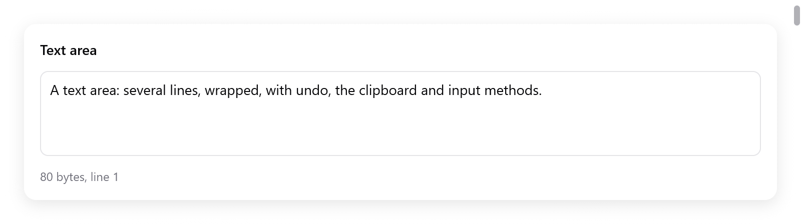

<a id="text-area"></a>

# Text area

`ui.textArea` sửa văn bản nhiều dòng, có ngắt dòng hoặc scroll ngang. Nó có đủ phím của nền tảng, con trỏ, clipboard, undo và bộ gõ.

- Văn bản của nó là một `ui.TextArea` do app giữ.
- Tài liệu là một rope: sửa văn bản trăm nghìn dòng cũng nhanh như sửa văn bản mười dòng.
- Chỉ các dòng đang hiện mới được tính layout.
- [Code editor](code-editor.md) được dựng từ chính những phần này.

Với văn bản một dòng, dùng `ui.textField` ([Nhập chữ](text-input.md)).

<!-- demo: text-area height=248 -->



*Một text area nhiều dòng, kèm số byte và dòng của con trỏ nhập.*

```zig
const Notes = struct {
    body: ui.TextArea,

    fn view(s: *Notes, c: *ui.Context) void {
        const r = ui.textArea(c, &s.body, .{ .placeholder = "Notes", .lines = .{ 3, 12 } });
        if (r.changed) s.save();
    }
};

var notes: Notes = .{ .body = .init(gpa, "Hello") };
defer notes.body.deinit();
```

`zig build run-text-buffer` sửa 100 000 dòng (`examples/text-buffer`). Trang Text của gallery và `examples/code-editor` cũng có text area.

<a id="options"></a>

## Tùy chọn

`ui.TextAreaOptions`:

| trường | mặc định | ý nghĩa |
|---|---|---|
| `width` | `.fill` | chiều rộng |
| `height` | 140 điểm | chiều cao |
| `lines` | null | cao dần theo văn bản, từ `lines[0]` hàng tới `lines[1]` hàng, quá đó thì scroll, như ô soạn tin nhắn (thay cho `height`) |
| `size` | 14 | cỡ chữ |
| `mono` | false | font monospace |
| `wrap` | true | ngắt dòng dài; false thì scroll ngang, có thanh scroll |
| `placeholder` | `""` | hiện khi còn trống |
| `read_only` | false | chọn và copy được, không sửa được |
| `tab` | false | Tab gõ ra ký tự tab, thay vì chuyển focus |
| `bare` | false | không có box riêng (viền, nền, vòng focus): cho editor chiếm cả cửa sổ |

Nó trả về một `ui.TextAreaResult`:

| trường | |
|---|---|
| `changed` | văn bản đã đổi trong frame này |
| `focused` | nó đang có focus |
| `first_line`, `last_line` | các dòng nó đã dựng |
| `lines` | mỗi dòng đã dựng và mép trên của nó tính từ mép trên view, theo vị trí scroll, nằm trong bộ nhớ của frame |
| `row_h` | chiều cao một hàng |

`lines` và `row_h` dùng cho những gì app vẽ đè lên các dòng.

<a id="editing"></a>

## Chỉnh sửa

Mọi thứ mà ô nhập chữ của nền tảng làm được:

- Phím mũi tên, giữ Shift để chọn. Theo từng từ với Option (macOS) hoặc Control (Linux, Windows). Tới hai đầu dòng với Command hoặc Home và End. Tới hai đầu văn bản. Page Up và Page Down.
- Lên và xuống giữ nguyên cột lúc bắt đầu.
- Backspace và Delete, theo ký tự, theo từ, và tới đầu dòng.
- Chọn tất cả, copy, cut và paste qua clipboard của hệ thống (trong test là clipboard riêng của `ui.Tester`).
- Undo và redo. Các ký tự gõ liền nhau trong vòng một giây là một bước. Các lần xóa liền nhau cũng vậy.
- Bộ gõ (tiếng Trung, Nhật, Hàn, dead key). Phần đang soạn được gạch chân trong văn bản cho tới khi xác nhận.
- Con trỏ: bấm để đặt con trỏ nhập, kéo để chọn. Bấm đúp chọn một từ, bấm ba lần chọn một dòng; kéo tiếp từ đó thì chọn theo từ hoặc dòng. Shift-bấm mở rộng vùng chọn.

**Nhiều con trỏ nhập** (`src/ui/textarea_multi.zig`):

- Control-Alt (Command-Option) với Lên hoặc Xuống thêm một con trỏ ở dòng trên hoặc dưới.
- Control-D (Command-D) chọn từ tại con trỏ, rồi lần lượt từng chỗ khớp tiếp theo.
- Control-bấm (Command-bấm) thêm một con trỏ ở chỗ bấm.
- Khi đó gõ, xóa, Tab, Enter, cut và phím mũi tên tác động ở mọi con trỏ, gộp thành một bước undo. Escape quay về một con trỏ.
- Con trỏ chính nằm trong `sel`, các con trỏ khác trong `TextArea.extra`.

Trên macOS, phím đi qua hệ thống nhập văn bản (`NSTextInputClient`), nên các phím tắt riêng của người dùng vẫn có tác dụng. Ở nơi khác, phím được ánh xạ theo cách nền tảng đó gán (`src/ui/textarea_keys.zig`).

<a id="the-state"></a>

## State

Một `ui.TextArea` giữ:

- tài liệu: `doc`, một `ui.TextDoc`;
- vùng chọn: `sel`, một `ui.TextSel` gồm hai offset byte `anchor` và `caret`;
- phần đang soạn của bộ gõ;
- những gì view giữ lại giữa các frame.

Tạo bằng `ui.TextArea.init(gpa, text)`, giải phóng bằng `deinit()`. App đọc và thay đổi nó giữa các frame:

| method | việc nó làm |
|---|---|
| `text(gpa)` | toàn bộ văn bản, trong bộ nhớ của `gpa` |
| `len()` | độ dài tính bằng byte |
| `setText(s)` | thay văn bản như một lần sửa, undo được |
| `reset(s)` | thay bằng một tài liệu mới, không có lịch sử (như khi mở file) |
| `select(anchor, caret)`, `collapse(at)` | đặt vùng chọn |
| `selectedText(gpa)` | văn bản trong vùng chọn |
| `caretLine()` | dòng của con trỏ nhập, đếm từ 0 |
| `insert(s)` | gõ `s` tại con trỏ nhập, như bàn phím |
| `replaceSelection(s, kind)`, `replaceRange(a, b, s, kind)` | thay văn bản, thành một bước undo |
| `deleteTo(at)` | xóa vùng chọn, hoặc từ con trỏ nhập tới `at` |
| `undo()`, `redo()` | |
| `takeChanged()` | văn bản có đổi từ lần gọi trước hay không |
| `wordAt(i)`, `lineRange(line)` | khoảng của một từ và một dòng |
| `prevChar`, `nextChar`, `prevWord`, `nextWord` | ranh giới tính từ một byte |

```zig
if (ui.button(c, "Insert date", .{}).clicked) {
    s.body.insert(c.print("{d}-{d:0>2}-{d:0>2}", .{ y, m, d }));
}
if (ui.button(c, "Clear", .{ .disabled = s.body.len() == 0 }).clicked) s.body.setText("");
```

Offset là byte của UTF-8. Con trỏ nhập không bao giờ dừng giữa một ký tự.

<a id="the-document"></a>

## Tài liệu

`ui.TextDoc` là văn bản mà text area hoặc code editor sửa. Nó giữ:

- một rope;
- lịch sử undo;
- nhật ký các dòng mà mỗi lần sửa đã thay. View đọc nhật ký này để cập nhật những gì nó giữ theo từng dòng (các hàng đã ngắt, state tô màu cú pháp) mà không phải xem phần còn lại của tài liệu.

Có thể dùng nó riêng:

```zig
var doc = ui.TextDoc.init(gpa, source);
defer doc.deinit();
doc.replace(0, 0, "// Generated.\n"); // một bước undo
const first = doc.line(gpa, 0);        // không kèm ký tự xuống dòng
```

- Đọc: `len()`, `lineCount()`, `lineStart(i)`, `lineEnd(i)`, `lineOf(offset)`, `byteAt(i)`, `line(gpa, i)`, `slice(gpa, a, b)`, `text(gpa)`.
- Sửa: `replace(a, b, s)` và `set(s)` mỗi lệnh là một bước undo. `reset(s)` bắt đầu một tài liệu mới.
- Nhiều lần sửa gộp thành một bước giữa `begin(kind, sel, time)` và `end(sel)`, mỗi lần sửa dùng `edit(a, b, s)`.
- Lịch sử: `undo()` và `redo()` trả về vùng chọn cần khôi phục. Có thêm `canUndo()` và `canRedo()`.
- `max_undo` là 1000 bước. `group_seconds` là 1 giây: gõ trong khoảng đó thì gộp vào bước trước. `breakGroup()` làm lần gõ kế tiếp thành một bước riêng.
- Thay đổi: mỗi lần sửa tăng `version`. `spliceSeq()` là một số thứ tự.
- `splicesSince(seen)` cho các splice kể từ một số thứ tự: mỗi splice là một dòng, số dòng nó đã thay và số dòng nó đặt vào. Nó là null khi các splice đó đã bị bỏ, và bên đọc phải đọc lại tất cả.

<a id="the-rope"></a>

## Rope

`ui.Rope` là văn bản dưới dạng cây cân bằng (AVL) gồm các đoạn UTF-8, theo rope của Zed.

- Mỗi lá giữ tối đa 2 KB. Mỗi nhánh đếm số byte và số ký tự xuống dòng bên dưới nó.
- Một lần sửa chỉ chạm tới các lá nó đổi và đường đi tới chúng.
- Đầu một dòng, dòng chứa một byte và một khoảng văn bản đều tìm được trong O(log n).
- `replace(a, b, s)`, `lineStart(line)`, `lineOf(at)`, `slice(gpa, a, b)`, `chunks(from)` và `lines(gpa, first)` duyệt qua nó.
- Khác rope của mygo, cây được sửa tại chỗ. Undo giữ các lần sửa, không giữ các phiên bản.

<a id="large-texts"></a>

## Văn bản lớn

- Chỉ các hàng đang hiện được dựng, thêm vài hàng phía trên và dưới. Một frame chỉ tốn bằng một màn hình.
- Các hàng đã ngắt được đo một lần và giữ theo từng dòng, cập nhật từ các splice của tài liệu. Thanh scroll biết chiều cao văn bản mà không phải tính layout toàn bộ.
- Với `wrap = false`, dòng dài scroll ngang. Dòng rộng nhất đã hiện tới giờ quyết định kích thước thanh scroll ngang.

**Dòng dài.** Dòng từ 4 KB trở lên là code đã minify, log không xuống dòng, một megabyte dữ liệu trên một dòng. Nó được tính layout theo từng mẩu tối đa 256 byte, giữ cùng các hàng của nó qua các frame (`textlayout_long.zig`):

- Mỗi frame shape và ngắt tối đa 32 KB của các dòng dài mà nó hiện.
- Một dòng cực dài hiện ngay vài hàng đầu, phần còn lại hiện dần trong các frame sau, thay vì làm treo frame hiện nó.
- Một lần sửa giữ nguyên các mẩu phía trước. Gõ trong một dòng dài chỉ shape lại mẩu đang gõ và các mẩu sau đó.
- Với dòng không ngắt, chỉ phần đang hiện được vẽ, không phải cả dòng.

<a id="testing"></a>

## Test

```zig
var s: Notes = .{ .body = .init(gpa, "") };
defer s.body.deinit();
var t: ui.Tester = undefined;
try t.init(gpa, .init(&s, Notes.view), .{});
defer t.deinit();
try t.clickText("Notes");     // placeholder: bấm vào để focus
t.typeText("Hello\nworld");
const text = s.body.text(gpa);
defer gpa.free(text);
try std.testing.expectEqualStrings("Hello\nworld", text);
```

`ui.Tester` gõ ký tự, phím, tổ hợp phím (`t.shortcut`) và các thao tác của bộ gõ (`t.textOps`). Nó có clipboard riêng. Xem `src/ui/tests_textarea.zig` và [Test](testing.md).
