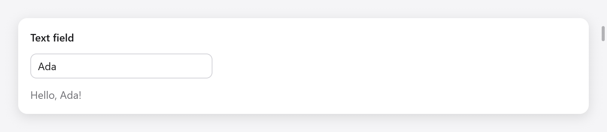
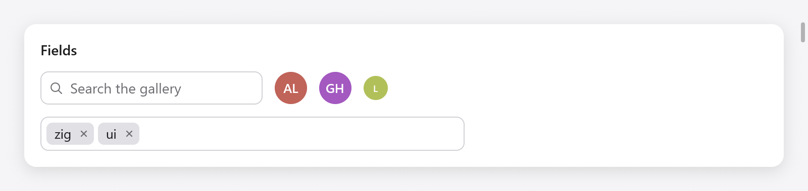

<a id="text-input"></a>

# Nhập văn bản

`ui.textField` chỉnh sửa một dòng văn bản được lưu giữ ở trạng thái của bạn, trong `ui.TextBuffer`. Xung quanh nó là các trường được xây dựng trên đó: trường tìm kiếm, trường mã thông báo gồm các chip, hộp tổ hợp và tự động hoàn thành. Đối với một số dòng, hãy xem [vùng văn bản](text-area.md); đối với mã, [trình soạn thảo mã](code-editor.md).

<a id="text-fields"></a>



*Ô nhập chứa Ada; view hiển thị lời chào tương ứng.*

## Trường văn bản

```zig
const State = struct {
    name: ui.TextBuffer = .{},
};

fn view(s: *State, c: *ui.Context) void {
    // ...
    const r = ui.textField(c, &s.name, .{ .placeholder = "Your name" });
    if (r.submitted) s.greet();
    const name = s.name.text();
    ui.text(c, if (name.len == 0) "Type to be greeted." else c.print("Hello, {s}!", .{name}), .{});
}
```

Một trường lấy tiêu điểm bàn phím khi được nhấp vào (hoặc bằng Tab), hiển thị dấu mũ và vùng chọn, cuộn sang một bên để giữ dấu mũ trong tầm nhìn và giảm bớt vòng màu nhấn xung quanh trường đó khi lấy tiêu điểm. Nó chỉnh sửa thông qua cách nhập văn bản của nền tảng: gõ, dấu và phương thức nhập, tổ hợp phím của hệ thống, lựa chọn bằng bàn phím và chuột (chọn kéo, nhấp đúp vào một từ) và bảng tạm.

`TextBuffer.set(text)` thay thế văn bản và đặt dấu mũ ở cuối văn bản; `TextBuffer.select(anchor, caret)` chọn byte trong khung tiếp theo, vì hộp đổi tên tệp sẽ chọn tên của nó mà không có phần mở rộng.

`ui.TextFieldOptions`:

| lĩnh vực | mặc định | nó làm gì |
|---|---|---|
| `placeholder` | `""` | văn bản mờ hiển thị trong khi nó trống |
| `width` | 240 điểm | một `ui.Length`; `.fill` trên cha mẹ của nó |
| `size` | 14 | kích thước của văn bản |
| `disabled` | false | làm mờ, chặn chỉnh sửa và bỏ ô nhập khỏi thứ tự Tab |
| `password` | false | dấu đầu dòng thay vì văn bản và văn bản được giữ ngoài bảng nhớ tạm |
| `suggestion` | `""` | văn bản được vẽ mờ sau những gì được gõ, như sự tự gợi ý của shell; → hoặc End ở cuối văn bản lấy nó |
| `bare` | false | không có hộp riêng (viền, tô màu, vòng tiêu điểm), dành cho trường bên trong khung lớn hơn, với tư cách là người soạn thảo trò chuyện |
| `label` | `""` | đặt tên nó theo công nghệ hỗ trợ (một [trường của biểu mẫu](forms.md) đặt tên riêng cho nó) |

Nó trả về một kết quả:

| lĩnh vực | true khi |
|---|---|
| `changed` | văn bản đã thay đổi trong khung này |
| `submitted` | Trở lại đã được nhấn |
| `focused` | nó có tiêu điểm bàn phím |
| `accepted` | gợi ý đã được đưa vào văn bản |
| `caret` | (a `usize`) độ lệch byte của dấu mũ sau khi chỉnh sửa khung này |

<a id="the-buffer"></a>

## Bộ đệm

Dùng [Input Group](input-group.md) để ghép ô nhập với icon, tiền tố/hậu tố và nút trong cùng khung.

`ui.TextBuffer` chứa tới 1024 byte UTF-8, nội tuyến, không phân bổ: giữ nó ở trạng thái của bạn.

| phương pháp | nó làm gì |
|---|---|
| `text()` | văn bản, một lát đệm |
| `set(s)` | thay thế văn bản; dấu mũ đi đến cuối của nó |
| `clear()` | làm trống nó |
| `insert(at, s)` | chèn vào byte `at`; trả về bao nhiêu byte đã đi vào |
| `remove(from, to)` | xóa byte `[from, to)` |
| `replace(from, to, s)` | thay thế byte `[from, to)` bằng càng nhiều `s` càng phù hợp, không bao giờ cắt chuỗi UTF-8 |

Cài đặt `want_caret` sẽ đặt dấu mũ vào khung tiếp theo sau khi ứng dụng thay đổi văn bản. Sao chép văn bản ra (`dupe`) để giữ nó sau khi bộ đệm thay đổi.

```zig
if (r.submitted or ui.button(c, "Add", .{ .variant = .primary }).clicked) {
    s.add(std.mem.trim(u8, s.task.text(), " "));
    s.task.clear();
}
```

<a id="editing"></a>

## Chỉnh sửa

Các khóa mà một trường hiểu được đến từ nền tảng: trên macOS, các liên kết khóa của AppKit thông qua hệ thống nhập văn bản (vì vậy các liên kết của chính người dùng cũng hoạt động); ở nơi khác, các khóa thông thường của Linux và Windows. Mỗi cái sẽ trở thành `ui.TextCommand` được áp dụng cho văn bản có tiêu điểm:

- di chuyển dấu mũ theo ký tự, từ và đến cuối dòng, đồng thời mở rộng vùng chọn theo cách tương tự với Shift (`move_word_left`, `select_line_end`, ...);
- xóa lùi, xóa tiến, theo ký tự, từ và đến đầu dòng;
- chọn tất cả, sao chép, cắt và dán;
- Lên, Xuống, Lên trang, Xuống trang và phần cuối của tài liệu, trong trường một dòng sẽ đi đến phần cuối của văn bản.

Các dòng mới được dán sẽ trở thành khoảng trắng trong trường một dòng. Trên macOS, Cắt, Sao chép, Dán và Chọn Tất cả của menu Chỉnh sửa cũng đạt đến trường được tập trung.

<a id="input-methods"></a>

## Phương thức nhập

Trên macOS, view native là `NSTextInputClient` (`src/ui/textinput.zig`): dấu (giữ một phím), Trình xem ký tự, đọc chính tả và các phương thức nhập của tiếng Trung, tiếng Nhật và tiếng Hàn trong mọi trường, văn bản được soạn thảo được hiển thị được gạch chân, với cửa sổ ứng viên ở dưới dấu mũ. Trên Linux, ngữ cảnh phương thức nhập của GTK cung cấp cho trường văn bản mà nó cam kết. Trên Windows, các ký tự đã nhập (và nội dung IME cam kết) sẽ xuất hiện dưới dạng ký tự. Trong trình duyệt, một vùng văn bản ẩn sẽ lấy bố cục, hiển thị được gạch chân.

<a id="search-fields"></a>

## Trường tìm kiếm



*Ô tìm kiếm, avatar và ô nhập thẻ chứa zig và ui.*

`ui.searchField(c, &query, options)` là một trường để tìm kiếm: kính lúp, văn bản và nút xóa nó trong khi nó giữ bất kỳ trường nào, như Escape thực hiện:

```zig
const r = ui.searchField(c, &s.query, .{ .placeholder = "Search the gallery" });
if (r.changed) s.filter();
if (r.cleared) s.showAll();
```

`ui.SearchFieldOptions`: `placeholder` (`"Search"`), `width` (220 điểm) và `size` (14). Kết quả (`ui.SearchResult`) có `changed`, `submitted`, `cleared` (nút xóa hoặc Escape đã làm trống nó) và `focused`.

<a id="token-fields"></a>

## Trường mã thông báo

`ui.tokenField(c, &tokens, suggestions, options)` chỉnh sửa một bộ mã thông báo, dưới dạng thẻ hoặc người nhận thư: các khối, mỗi khối có một nút để lấy mã thông báo ra, gói thành nhiều dòng hơn, trước trường văn bản trong đó Enter hoặc dấu phẩy sẽ thêm nội dung đã nhập và Backspace khi trống sẽ xóa dòng cuối cùng. Các đề xuất chứa nội dung đã nhập (bỏ qua chữ hoa chữ thường và chưa có mã thông báo) hiển thị bên dưới: Up và Down di chuyển giữa chúng và Enter hoặc một cú nhấp chuột sẽ thêm một mã. Nó trả về true khi mã thông báo thay đổi:

```zig
const tags = [_][]const u8{ "design", "docs", "bug", "feature", "performance", "ui", "zig" };

const State = struct {
    tokens: ui.Tokens = .{},
};

_ = ui.tokenField(c, &s.tokens, &tags, .{ .placeholder = "Add a tag", .width = 420 });
```

`ui.Tokens` chứa tối đa 64 mã thông báo có tổng dung lượng 2 KB, nội tuyến và văn bản đang được nhập (`query`). `get(i)`, `count`, `contains(s)`, `append(s)` (cắt bớt; false nếu trống, đã có hoặc quá lâu so với những gì còn lại) và `remove(i)` đọc và thay đổi nó từ ứng dụng. `ui.TokenFieldOptions`: `placeholder`, `width` (300 điểm) và `max_suggestions` (8).

<a id="comboboxes"></a>

## Hộp tổ hợp


*Select, combobox chọn phông chữ và ô tự động gợi ý thành phố.*

`ui.combobox(c, &selected, options, &state, field_options)` chọn một trong `options` (chuỗi) thành `selected` (a `?usize`). Nó cho thấy sự lựa chọn; một cú nhấp chuột hoặc Xuống hiển thị tất cả các tùy chọn (nhấp chuột sẽ chọn văn bản, do đó việc nhập sẽ thay thế nó), việc nhập sẽ lọc chúng và văn bản sẽ quay lại lựa chọn khi trường mất tiêu điểm:

```zig
const fonts = [_][]const u8{ "Avenir", "Futura", "Georgia", "Helvetica", "Menlo", "Palatino" };

const State = struct {
    font: ?usize = 3,
    font_box: ui.ComboboxState = .{},
};

const r = ui.combobox(c, &s.font, &fonts, &s.font_box, .{ .placeholder = "Font", .width = .{ .px = 180 } });
if (r.changed) s.applyFont();
```

`ui.ComboboxState` giữ danh sách và văn bản đã nhập; giữ nó ở trạng thái của bạn, mỗi cái một hộp tổ hợp. Kết quả có `changed` (một tùy chọn mới đã được chọn), `open` và `focused`. Trong danh sách mở, các mũi tên di chuyển, Enter chọn và Escape đóng danh sách (không phải tiêu điểm của trường).

<a id="autocomplete"></a>

## Tự động hoàn thành

`ui.autocomplete(c, &buffer, suggestions, &state, field_options)` là một trường văn bản có văn bản là của ứng dụng (a `ui.TextBuffer`), bên dưới nó đề xuất nội dung của `suggestions` chứa nội dung đã nhập. Di chuyển Up và Down giữa chúng, Enter hoặc một cú nhấp chuột chỉ mất một lần và Enter nếu không gửi:

```zig
const cities = [_][]const u8{ "Amsterdam", "Berlin", "Lisbon", "London", "Madrid", "Paris" };

const r = ui.autocomplete(c, &s.city, &cities, &s.city_box, .{ .placeholder = "City" });
if (r.submitted) s.search(s.city.text());
```

`ui.AutocompleteState` giữ danh sách. Kết quả có `changed` (đã nhập hoặc đã thực hiện đề xuất), `submitted`, `open` và `focused`. `ui.ComboFieldOptions`, được chia sẻ bởi cả hai: `placeholder`, `width` (240 điểm, `ui.Length`) và `size` (14).

Một menu gồm các lựa chọn cố định không cần gõ là một lựa chọn; xem [menu](menus.md).

<a id="text-that-a-widget-takes-itself"></a>

## Văn bản mà một widget tự lấy

Một widget của riêng bạn giúp chỉnh sửa văn bản, đọc các thao tác của sự kiện thay vì các khóa của sự kiện: `c.input.ops` là một phần của `ui.TextOp`, mỗi phần trong số đó

- `.insert`: gõ hoặc dán văn bản;
- `.set_marked`: thành phần của phương thức nhập, với lựa chọn bên trong nó, được hiển thị gạch chân cho đến khi nó được cam kết hoặc `.unmark`ed;
- `.command`: a `ui.TextCommand` (`.delete_backward`, `.move_word_left`, `.select_all`, `.copy`, `.insert_newline`, `.cancel`, ...).

Đặt `c.focused_text` mỗi khung cho văn bản, lựa chọn của nó và vị trí dấu mũ được vẽ, để phương thức nhập có thể hỏi về chúng giữa các khung và đặt cửa sổ ứng viên của nó. [Vùng văn bản](text-area.md) và [trình soạn thảo mã](code-editor.md) được xây dựng theo cách này; kiểm tra hoạt động cấp dữ liệu bằng `Tester.textOps` và nhập bằng `Tester.typeText`.
