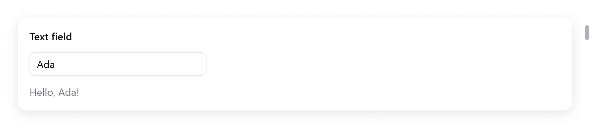
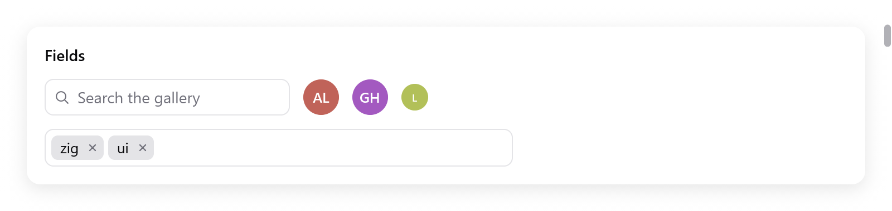
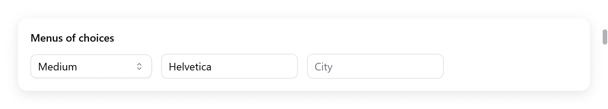

<a id="text-input"></a>

# Nhập văn bản

`ui.textField` sửa một dòng chữ lưu trong state của bạn, trong một `ui.TextBuffer`. Dựng trên nó có search field, token field gồm các chip, combobox và autocomplete. Nhiều dòng thì xem [text area](text-area.md); code thì xem [code editor](code-editor.md).

<!-- demo: text-input height=120 -->



*Text field chứa Ada; view hiện lời chào ngay lập tức.*

<a id="text-fields"></a>

## Text field

```zig
const State = struct {
    name: ui.TextBuffer = .{},
};

fn view(s: *State, c: *ui.Context) void {
    // ...
    const r = ui.textField(c, &s.name, .{ .placeholder = "Your name" });
    if (r.submitted) s.greet();
    const name = s.name.text();
    ui.text(c, if (name.len == 0) "Type to be greeted." else c.print("Hello, {s}!", .{name}), .{});
}
```

- Bấm vào hoặc Tab tới thì field nhận focus bàn phím.
- Nó hiện con trỏ soạn thảo và vùng chọn, và scroll ngang để con trỏ luôn trong tầm nhìn.
- Khi có focus, một vòng màu accent hiện dần quanh nó.
- Nó sửa chữ qua cơ chế nhập văn bản của nền tảng: gõ phím, dấu và bộ gõ, phím tắt của hệ thống, và clipboard.
- Chọn bằng bàn phím và chuột: kéo để chọn, bấm đúp để chọn một từ.
- `TextBuffer.set(text)` thay chữ và đặt con trỏ ở cuối.
- `TextBuffer.select(anchor, caret)` chọn các byte ở frame kế tiếp, như ô đổi tên file chọn sẵn phần tên mà bỏ phần mở rộng.

`ui.TextFieldOptions`:

| Trường | Mặc định | Tác dụng |
|---|---|---|
| `placeholder` | `""` | chữ mờ hiện khi field trống |
| `width` | 240 điểm | một `ui.Length`; `.fill` để trải hết phần tử cha |
| `size` | 14 | cỡ chữ |
| `disabled` | false | làm mờ field, không cho sửa và bỏ nó khỏi vòng Tab |
| `password` | false | hiện dấu chấm thay cho chữ, và không cho chữ vào clipboard |
| `suggestion` | `""` | chữ mờ vẽ sau phần đã gõ, như gợi ý tự động của shell; → hoặc End ở cuối chữ thì nhận gợi ý |
| `bare` | false | không có khung riêng (viền, nền, vòng focus), cho field nằm trong một khung lớn hơn, như ô soạn tin nhắn chat |
| `caret_width` | 1.5 | độ rộng con trỏ soạn thảo tính bằng điểm, ít nhất một pixel thiết bị; 0 thì ẩn nó, field vẫn sửa được (text area cũng nhận tùy chọn này) |
| `label` | `""` | tên cho công nghệ hỗ trợ tiếp cận ([trường của form](forms.md) tự đặt tên) |

Nó trả về một kết quả:

| Trường | true khi |
|---|---|
| `changed` | chữ thay đổi trong frame này |
| `submitted` | người dùng bấm Return |
| `focused` | field đang có focus bàn phím |
| `accepted` | gợi ý đã được nhận vào chữ |
| `caret` | (một `usize`) vị trí byte của con trỏ sau các thay đổi trong frame này |

Dùng [Input Group](input-group.md) để chung khung với icon, tiền tố/hậu tố và nút hành động.

<a id="the-buffer"></a>

## Buffer

`ui.TextBuffer` giữ tối đa 1024 byte UTF-8, nằm ngay trong struct, không cấp phát: cứ để nó trong state.

| Method | Tác dụng |
|---|---|
| `text()` | chữ, một slice của buffer |
| `set(s)` | thay chữ; con trỏ về cuối |
| `clear()` | xóa trắng |
| `insert(at, s)` | chèn ở byte `at`; trả về số byte đã chèn |
| `remove(from, to)` | xóa các byte `[from, to)` |
| `replace(from, to, s)` | thay các byte `[from, to)` bằng phần của `s` vừa đủ chỗ, không bao giờ cắt ngang một chuỗi UTF-8 |

- Đặt `want_caret` để đặt con trỏ ở frame kế tiếp, sau khi app đã đổi chữ.
- Copy chữ ra (`dupe`) nếu muốn giữ lại sau khi buffer thay đổi.

```zig
if (r.submitted or ui.button(c, "Add", .{ .variant = .primary }).clicked) {
    s.add(std.mem.trim(u8, s.task.text(), " "));
    s.task.clear();
}
```

<a id="editing"></a>

## Chỉnh sửa

Các phím field hiểu được lấy từ nền tảng:

- trên macOS, phím tắt của AppKit qua hệ thống nhập văn bản, nên phím tắt người dùng tự đặt cũng chạy;
- ở nơi khác, các phím quen thuộc của Linux và Windows.

Mỗi phím thành một `ui.TextCommand` áp lên chữ đang có focus:

- di chuyển con trỏ theo ký tự, theo từ và tới hai đầu dòng, và mở rộng vùng chọn theo cùng cách với Shift (`move_word_left`, `select_line_end`, ...);
- xóa lùi và xóa tới, theo ký tự và theo từ, và xóa tới đầu dòng;
- chọn tất cả, copy, cut và paste;
- Up, Down, Page Up, Page Down và hai đầu văn bản; trong field một dòng, chúng đưa con trỏ tới một đầu của chữ.

Trong field một dòng, dấu xuống dòng khi paste thành dấu cách. Trên macOS, Cut, Copy, Paste và Select All của menu Edit cũng tới được field đang có focus.

<a id="input-methods"></a>

## Bộ gõ

| Nền tảng | |
|---|---|
| macOS | view native là một `NSTextInputClient` (`src/ui/textinput.zig`) |
| Linux | input method context của GTK đưa cho field chữ mà bộ gõ commit |
| Windows | ký tự gõ vào, và chữ IME commit, đến dưới dạng ký tự |
| trình duyệt | một text area ẩn nhận chữ đang soạn, hiện có gạch chân |

Trên macOS, mọi field đều nhận dấu (giữ một phím), Character Viewer, đọc chính tả, và bộ gõ tiếng Trung, Nhật, Hàn. Chữ đang soạn hiện có gạch chân, với cửa sổ chọn chữ ngay dưới con trỏ.

<a id="search-fields"></a>

## Search field

<!-- demo: fields height=214 -->



*Một search field, các avatar và một token field chứa zig và ui.*

```zig
const r = ui.searchField(c, &s.query, .{ .placeholder = "Search the gallery" });
if (r.changed) s.filter();
if (r.cleared) s.showAll();
```

`ui.searchField(c, &query, options)` là field để tìm kiếm: một kính lúp, chữ, và một nút xóa chữ. Nút hiện khi field có chữ; lúc đó Escape cũng xóa chữ.

- `ui.SearchFieldOptions`: `placeholder` (`"Search"`), `width` (220 điểm) và `size` (14).
- Kết quả (`ui.SearchResult`) có `changed`, `submitted`, `cleared` (nút xóa hoặc Escape đã làm trống field) và `focused`.

<a id="token-fields"></a>

## Token field

```zig
const tags = [_][]const u8{ "design", "docs", "bug", "feature", "performance", "ui", "zig" };

const State = struct {
    tokens: ui.Tokens = .{},
};

_ = ui.tokenField(c, &s.tokens, &tags, .{ .placeholder = "Add a tag", .width = 420 });
```

`ui.tokenField(c, &tokens, suggestions, options)` sửa một tập token, như tag hay người nhận email. Nó trả về true khi các token thay đổi.

- Mỗi token là một chip có nút để bỏ nó đi. Các chip xuống dòng khi hết chỗ, đứng trước một text field.
- Enter hoặc dấu phẩy thêm chữ vừa gõ. Backspace khi field trống thì bỏ token cuối.
- Các gợi ý chứa chữ vừa gõ hiện bên dưới. Không phân biệt hoa thường, và bỏ qua token đã có.
- Up và Down di chuyển giữa các gợi ý; Enter hoặc bấm thì thêm một gợi ý.

`ui.Tokens` giữ tối đa 64 token, tổng cộng 2 KB, ngay trong struct, cùng chữ đang gõ (`query`). App đọc và sửa nó bằng:

- `get(i)`, `count`, `contains(s)`;
- `append(s)`: cắt khoảng trắng; false nếu trống, đã có, hoặc quá dài so với chỗ còn lại;
- `remove(i)`.

`ui.TokenFieldOptions`: `placeholder`, `width` (300 điểm) và `max_suggestions` (8).

<a id="comboboxes"></a>

## Combobox

<!-- demo: selects height=168 -->



*Một select, combobox chọn font và field autocomplete chọn thành phố.*

```zig
const fonts = [_][]const u8{ "Avenir", "Futura", "Georgia", "Helvetica", "Menlo", "Palatino" };

const State = struct {
    font: ?usize = 3,
    font_box: ui.ComboboxState = .{},
};

const r = ui.combobox(c, &s.font, &fonts, &s.font_box, .{ .placeholder = "Font", .width = .{ .px = 180 } });
if (r.changed) s.applyFont();
```

`ui.combobox(c, &selected, options, &state, field_options)` chọn một trong các `options` (chuỗi) vào `selected` (một `?usize`).

- Nó hiện lựa chọn hiện tại.
- Bấm hoặc Down thì hiện mọi lựa chọn. Cú bấm chọn sẵn chữ, nên gõ vào sẽ thay chữ đó.
- Gõ để lọc các lựa chọn.
- Khi field mất focus, chữ trở về lựa chọn hiện tại.
- Trong danh sách đang mở, phím mũi tên di chuyển, Enter chọn và Escape đóng danh sách (field vẫn giữ focus).
- `ui.ComboboxState` giữ danh sách và chữ đã gõ. Để mỗi combobox một cái trong state.
- Kết quả có `changed` (vừa chọn một lựa chọn mới), `open` và `focused`.

<a id="autocomplete"></a>

## Autocomplete

```zig
const cities = [_][]const u8{ "Amsterdam", "Berlin", "Lisbon", "London", "Madrid", "Paris" };

const r = ui.autocomplete(c, &s.city, &cities, &s.city_box, .{ .placeholder = "City" });
if (r.submitted) s.search(s.city.text());
```

`ui.autocomplete(c, &buffer, suggestions, &state, field_options)` là một text field mà chữ thuộc về app (một `ui.TextBuffer`). Bên dưới, nó gợi ý những mục trong `suggestions` có chứa chữ đã gõ.

- Up và Down di chuyển giữa các gợi ý, Enter hoặc bấm thì nhận một gợi ý, và Enter khi không chọn gợi ý nào thì submit.
- `ui.AutocompleteState` giữ danh sách.
- Kết quả có `changed` (đã gõ hoặc đã nhận một gợi ý), `submitted`, `open` và `focused`.

`ui.ComboFieldOptions`, dùng chung cho cả hai: `placeholder`, `width` (240 điểm, một `ui.Length`) và `size` (14).

Menu gồm các lựa chọn cố định, không gõ được, là select; xem [menu](menus.md).

<a id="text-that-a-widget-takes-itself"></a>

## Widget tự nhận chữ

Widget tự viết mà sửa chữ thì đọc các thao tác của event chứ không đọc phím. `c.input.ops` là một slice các `ui.TextOp`, mỗi cái là một trong:

- `.insert`: chữ gõ vào hoặc paste;
- `.set_marked`: chữ bộ gõ đang soạn, kèm vùng chọn bên trong, hiện có gạch chân cho tới khi được commit hoặc `.unmark`;
- `.command`: một `ui.TextCommand` (`.delete_backward`, `.move_word_left`, `.select_all`, `.copy`, `.insert_newline`, `.cancel`, ...).

Mỗi frame, đặt `c.focused_text` là chữ, vùng chọn và vị trí vẽ con trỏ soạn thảo. Nhờ đó bộ gõ hỏi được về chúng giữa các frame và đặt đúng cửa sổ chọn chữ.

[Text area](text-area.md) và [code editor](code-editor.md) được dựng theo cách này. Test đưa thao tác vào bằng `Tester.textOps` và gõ chữ bằng `Tester.typeText`.
