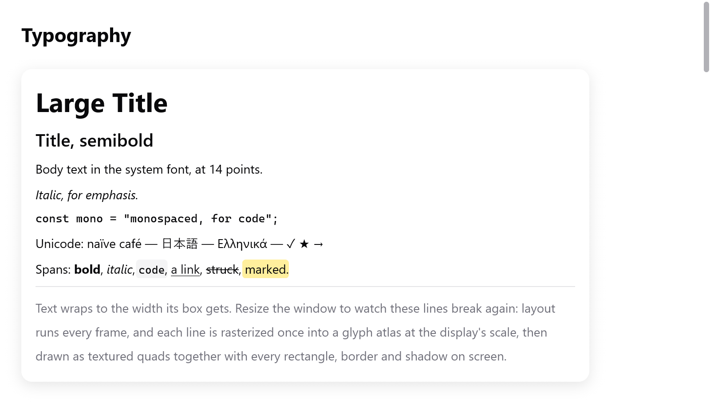

<a id="text"></a>

# Chữ

`ui.text` hiển thị một chuỗi theo một `ui.TextStyle`. `ui.textf` định dạng chuỗi trước, vào bộ nhớ của frame:

<!-- demo: text height=479 -->



*Heading bằng font hệ thống, chữ nghiêng và monospace, các span rich text và chữ xuống dòng.*

```zig
ui.text(c, "Large Title", .{ .size = 30, .weight = .bold });
ui.text(c, "Italic, for emphasis.", .{ .italic = true });
ui.text(c, "const mono = \"monospaced, for code\";", .{ .mono = true, .size = 13 });
ui.textf(c, .{ .mono = true, .size = 12 }, "{d:.0}%", .{s.volume * 100});
```

- Chuỗi, và các span của rich text, được copy vào bộ nhớ của frame. Layout đo và paint vẽ nó sau khi view trả về.
- Vì vậy view có thể giải phóng hoặc sửa bản copy của mình ngay sau `ui.text`, như hai pane lần lượt dựng lại cùng một danh sách tên.
- Chuỗi đã nằm trong bộ nhớ của frame (`c.print`, `c.alloc()`) cũng được copy. Với văn bản nhiều megabyte, chỉ hiển thị phần đang thấy, như `ui.textArea` và `ui.codeEditor` làm.

<a id="style"></a>

## Style

| Trường | Mặc định | Tác dụng |
|---|---|---|
| `size` | 14 | cỡ font, tính bằng điểm |
| `weight` | `.regular` | `.regular`, `.medium`, `.semibold` hoặc `.bold` |
| `color` | `c.theme.text` | màu chữ |
| `wrap` | false | xuống dòng cho vừa chiều rộng mà phần tử cha cho |
| `mono` | false | font monospace |
| `italic` | false | kiểu nghiêng, hoặc kiểu thường được làm nghiêng nếu họ font không có |
| `leading` | 1 | chiều cao dòng, tính theo bội số của font (1.4 hoặc 1.5 cho văn xuôi thoáng) |
| `family` | null | một họ font riêng, thay cho họ của theme (`font` hoặc `mono_font`) |
| `features` | `""` | các OpenType feature, cách nhau bằng dấu phẩy: `"calt=0,ss01"`, `"-liga"`, `"+zero"` (DirectWrite và HarfBuzz) |
| `weight_value` | 0 | độ đậm từ 100 đến 900 thay cho `weight`; 0 thì dùng `weight` |

```zig
ui.text(c, "Text wraps to the width its box gets. Resize the window to watch these lines break again.",
    .{ .wrap = true, .color = c.theme.muted, .leading = 1.4 });
```

- Chữ không xuống dòng thì rộng đúng bằng chính nó.
- Chữ xuống dòng lấy chiều rộng mà phần tử cha cho (`.fill`). Nó ngắt ở khoảng trắng thành bao nhiêu dòng cũng được.
- Trong một hàng thiếu chỗ, chữ xuống dòng nhường chỗ lại. Label cạnh một nút sẽ xuống dòng thay vì đẩy nút ra ngoài.

<a id="headings-and-labels"></a>

## Heading và label

```zig
ui.heading(c, "Settings");
ui.label(c, c.print("{d} of {d} left", .{ left, total }));
```

- `ui.heading(c, str)` là tiêu đề đậm 22 điểm. Trình đọc màn hình đọc nó như một heading.
- `ui.label(c, str)` là chữ 13 điểm màu mờ, cho chú thích và thông tin phụ.

<a id="rich-text"></a>

## Rich text

`ui.richText(c, str, spans, style)` vẽ một đoạn văn mà các khoảng byte có kiểu riêng. Mỗi `ui.Span` phủ các byte `[start, end)` và có thể đặt:

| Trường | Tác dụng |
|---|---|
| `color` | màu chữ (output ANSI, tô màu cú pháp) |
| `weight` | độ đậm khác |
| `italic` | chữ nghiêng |
| `mono` | font monospace (code inline), nhỏ hơn một chút cho cân |
| `background` | màu nền sau chữ (đánh dấu, code inline) |
| `underline`, `strike` | gạch dưới hoặc gạch ngang |

```zig
const s = "Spans: bold, italic, code, a link, struck, marked.";
// Span được copy, như chuỗi: bộ nhớ của frame hoặc của app.
const spans = c.alloc().dupe(ui.Span, &.{
    .{ .start = 7, .end = 11, .weight = .bold },
    .{ .start = 13, .end = 19, .italic = true },
    .{ .start = 21, .end = 25, .mono = true, .background = c.theme.surface_hover },
    .{ .start = 27, .end = 33, .color = c.theme.accent, .underline = true },
    .{ .start = 35, .end = 41, .strike = true },
    .{ .start = 43, .end = 49, .background = ui.Color.hex(0xffd60a).alpha(0.4) },
}) catch &.{};
ui.richText(c, s, spans, .{ .wrap = true });
```

- Span chỉ đổi màu, tô nền hoặc gạch dưới thì vẫn đi đường nhanh của chữ thường.
- Span đổi font (độ đậm, nghiêng, monospace) thì đoạn văn được shape thành nhiều run, xuống dòng xuyên qua chúng.
- Cả hai đều được cache qua các frame, như chữ thường.

Với cả một tài liệu, xem [Markdown](markdown.md). Nó vẽ heading, danh sách, code block và bảng từ văn bản Markdown. Với chữ do người dùng định dạng, xem [trình soạn thảo rich text](rich-text.md).

<a id="selectable-text"></a>

## Chữ chọn được

```zig
ui.column(c, .{ .selectable = true, .gap = 6 });
defer ui.end(c);
for (s.log_lines) |line| ui.text(c, line, .{ .mono = true, .size = 12 });
```

Một box có style `selectable = true` cho phép con trỏ chọn chữ của nó và của các phần tử con, như trong terminal hay trang web:

- Bấm vào chữ để bắt đầu chọn.
- Kéo để mở rộng vùng chọn qua nhiều dòng và nhiều box, theo thứ tự đọc. Kéo để chọn thì không tính là một cú bấm.
- Copy (⌘C hoặc Ctrl+C, hoặc menu Edit) copy vùng chọn, trừ khi text field đang có focus có vùng chọn riêng.
- Control bên trong (`control = true`, như nút, toggle và link) giữ chữ của chúng ngoài vùng chọn. Con trỏ là hình bàn tay trên toàn bộ control.

<a id="fonts"></a>

## Font

```zig
var t = ui.Theme.light;
t.font = "Inter";
t.mono_font = "JetBrains Mono";
_ = try app.newWindow(.{ .title = "Notes", .theme = t, .content = .{ .view = .init(&state, State.view) } });
```

Theme đặt tên các họ font, null là của hệ thống.

- Họ font chưa cài thì dùng họ của hệ thống.
- Khớp style sẽ chọn kiểu gần nhất của họ font: kiểu đậm cho `.bold`, kiểu nghiêng cho `.italic`, nếu không có thì kiểu thường được làm nghiêng khoảng 11 độ.

Font lấy từ đâu:

| Nền tảng | Font |
|---|---|
| macOS | CoreText shape và đo chữ bằng font hệ thống (SF Pro và SF Mono) |
| Linux, Windows, macOS với `-Dportable=true` | myzig tự đọc các font TrueType và OpenType đã cài (`src/ui/tt/`); phần shape ở [bên dưới](#how-text-is-drawn) |
| Trình duyệt | các font mà site đóng gói kèm (xem [trình duyệt](../browsers.md)) |

Ngoài macOS, các thư mục font của hệ thống được đọc một lần. Mỗi kiểu font được nhận biết theo họ, độ đậm, nghiêng và độ rộng, và được nạp ở lần dùng đầu, có kerning. Font dự phòng cung cấp các ký tự mà một font thiếu.

<a id="how-text-is-drawn"></a>

## Chữ được vẽ thế nào

Một đoạn chữ được shape một lần thành một layout: glyph, vị trí và các font dự phòng đã dùng. Việc đo và việc vẽ dùng chung layout này.

- Layout được cache khi còn dùng, nên một label không đổi thì không tốn gì để bố trí lại.
- Glyph được rasterize một lần vào một glyph atlas theo tỉ lệ của màn hình. Chúng được vẽ thành các quad có texture, cùng mọi hình chữ nhật, viền và bóng trong frame.
- Vì vậy chữ đổi mỗi frame (bộ đếm, đồng hồ) chỉ tốn một lần shape, không phải rasterize.
- Trên macOS, đường nhanh chính xác cho ASCII in được (`src/ui/shaper.zig`) bỏ qua CoreText với hầu hết label. Một test chứng minh nó bố trí chữ giống hệt CoreText.

Việc shape là của hệ thống:

| Nền tảng | Shape |
|---|---|
| macOS | CoreText |
| Windows | DirectWrite (`src/ui/text_dw*.zig`): tách script, font dự phòng của nó, đặt glyph, rasterize grayscale, emoji màu |
| Linux | HarfBuzz với FreeType và fontconfig (`src/ui/text_hb*.zig`, `text_ft.zig`, `text_fc.zig`), tất cả được nạp lúc chạy; emoji màu lấy từ bitmap màu |
| Không có các thư viện đó (Linux tối giản, trình duyệt) | bộ đọc TrueType của chính myzig (`src/ui/tt/`) |

- Chữ có nhiều hướng được chia thành các run theo thuật toán hai chiều của Unicode (`src/ui/bidi.zig`, UAX #9). Nó được bố trí theo thứ tự hiển thị.
- Con trỏ soạn thảo di chuyển theo thứ tự logic. Vùng chọn qua nhiều hướng hiện thành nhiều khoảng.
- Chữ Ả Rập được nối, và các ligature mà font có đều được dùng.
- Ký tự font thiếu (CJK, emoji) lấy từ font dự phòng.
- Chữ đơn giản có các ký tự đã gặp trước đó đi đường nhanh, cho ra cùng layout.

<a id="zoom"></a>

## Zoom

`c.setZoom(z)` phóng mọi chữ trong cửa sổ theo `z`, từ 0.5 đến 3, như ⌘= và ⌘- của một app. Box có kích thước theo chữ cũng lớn theo. Cỡ chữ của desktop đến qua [`ui.preferences.apply`](styling.md#the-desktops-preferences), hàm này đặt zoom.

<a id="icons"></a>

## Icon

`ui.icon` vẽ một ký hiệu theo tên, nằm trong dòng chữ; xem [nút và các thứ nhỏ](buttons.md#icons).
