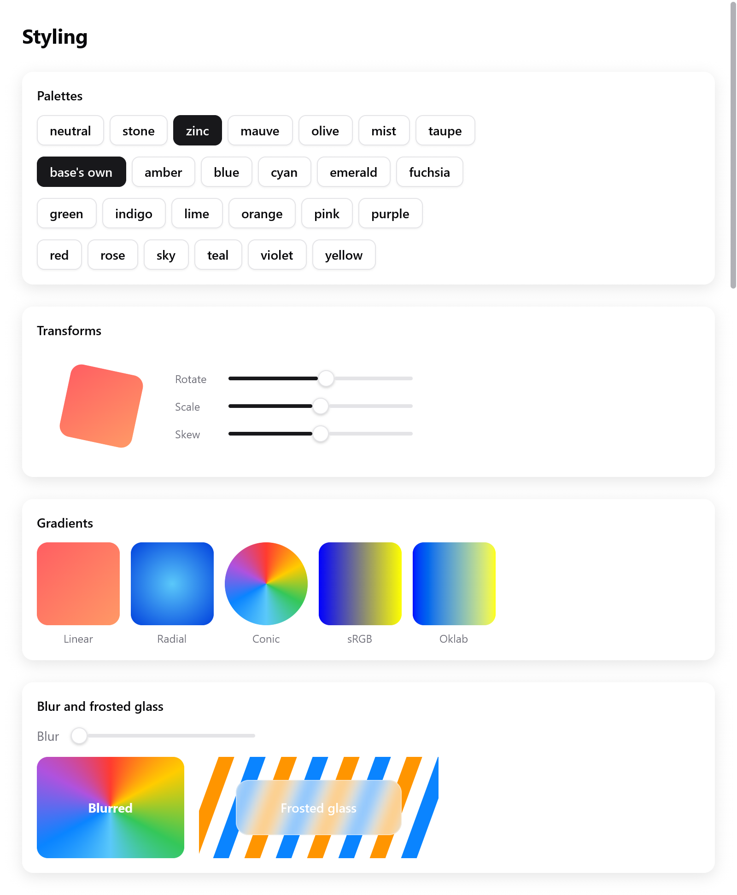

<a id="transforms-and-effects"></a>

# Transform và hiệu ứng

Dịch chuyển, phóng to thu nhỏ, xoay và làm nghiêng một box lúc vẽ, tô gradient cho nó, làm mờ nó, hoặc vẽ nó từ những gì nằm bên dưới như kính mờ.

- Tất cả là các trường của `ui.Style`, nên box nào cũng có.
- Mọi renderer đều vẽ chúng giống nhau: Metal, Direct3D 11, OpenGL, WebGL 2 và CPU.
- Trang Styling của gallery có ví dụ cho từng cái (`examples/gallery/motion.zig`).

<!-- demo: transforms height=520 -->



*Phép xoay, gradient, blur và nền kính mờ do myzig render.*

<a id="transforms"></a>

## Transform

```zig
_ = c.leaf(.{
    .width = .{ .px = 80 }, .height = .{ .px = 80 }, .radius = 12,
    .background = c.theme.accent,
    .transform = ui.Affine.rotation(s.rotate).then(.scaling(s.scale, s.scale)).then(.skewing(s.skew, 0)),
}, .none, null);
```

`Style.transform` là một `ui.Affine`, một phép biến đổi affine của mặt phẳng, như `transform` của CSS.

- Nó áp dụng sau layout, lên box và mọi thứ bên trong. Box vẫn giữ chỗ của nó, và các box cùng cấp không xê dịch.
- Nó lấy `Style.transform_origin` làm tâm, tính theo tỉ lệ của box: mặc định là chính giữa, `.{ .x = 0, .y = 0 }` là góc trên bên trái.

| Hàm | CSS |
|---|---|
| `Affine.translation(x, y)` | `translate(x, y)` |
| `Affine.scaling(sx, sy)` | `scale(sx, sy)`; giá trị âm thì lật |
| `Affine.rotation(degrees)` | `rotate()`, theo chiều kim đồng hồ trên màn hình |
| `Affine.skewing(x, y)` | `skew()`, tính bằng độ |
| `Affine{ .a, .b, .c, .d, .x, .y }` | `matrix(a, b, c, d, x, y)` |

Chúng kết hợp theo thứ tự gọi: `a.then(b)` là `a` rồi đến `b`.

| Phương thức | |
|---|---|
| `m.translate(x, y)`, `m.scale`, `m.rotate`, `m.skew` | viết tắt của `m.then(...)` |
| `m.about(point)` | lấy một điểm làm tâm thay cho gốc tọa độ |
| `m.apply(point)` | biến đổi một điểm |
| `m.inverse()` | phép biến đổi ngược; null nếu phép này ép dẹt mặt phẳng |
| `m.bounds(rect)` | hình chữ nhật nhỏ nhất chứa một hình chữ nhật sau biến đổi |

- Các góc xoay bội của 90 độ là chính xác.
- Transform của phần tử con áp dụng trước, rồi đến của phần tử cha.
- Box bị ép dẹt (scale bằng 0) không hiện gì và không nhận con trỏ.

<a id="the-pointer-follows-what-is-drawn"></a>

### Con trỏ đi theo hình được vẽ

Bấm, hover và kéo đến một box đã transform ở chỗ nó được vẽ, không phải chỗ layout đặt nó. Một nút bị xoay được bấm bên trong đường viền đã xoay của nó.

<details>
<summary>Hit testing làm việc này thế nào</summary>

Hit testing giữ hình chữ nhật riêng của từng box đã transform và phép biến đổi từ cửa sổ đến nó (`src/ui/hit.zig`).

</details>

<a id="how-transforms-are-drawn"></a>

### Transform được vẽ thế nào

Transform là thứ rẻ nhất để làm animation: animate nó không làm đổi layout. Xem [Motion](motion.md):

```zig
const s = ui.motion.to(c, "scale", if (hovered) 1.05 else 1, .snappy);
```

Chữ, viền, bóng và ảnh của một box bị nghiêng cũng được vẽ nghiêng theo.

<details>
<summary>Transform đơn giản và transform tổng quát</summary>

- Phần lớn transform chỉ dịch chuyển box và phóng to thu nhỏ đều hai chiều (`Affine.isSimilar`). Chúng được gộp thẳng vào box lúc paint, box vẫn là box bo góc bình thường, nên không tốn gì.
- Xoay, nghiêng và scale không đều giữ box trong hệ tọa độ riêng của cây con và gắn transform cho chúng. Renderer vẽ mỗi pixel theo vị trí của nó trong hệ tọa độ đó (`src/ui/paint_xf.zig`).

</details>

<a id="opacity-and-offset"></a>

## Opacity và offset

- `Style.opacity` làm mờ box cùng nội dung của nó.
- `Style.offset` dịch box sau layout mà không xê dịch các box cùng cấp, như một phép tịnh tiến. Nó cũng đặt vị trí cho box `absolute` bên trong phần tử cha.

<a id="gradients"></a>

## Gradient

```zig
const sunset: ui.Gradient = .{
    .stops = &.{ .{ .color = .hex(0xff5e62), .at = 0 }, .{ .color = .hex(0xff9966), .at = 1 } },
    .angle = 135,
};
const ocean: ui.Gradient = .{ .kind = .radial, .stops = &.{
    .{ .color = .hex(0x5ac8fa), .at = 0 }, .{ .color = .hex(0x0040dd), .at = 1 },
} };

_ = c.leaf(.{ .width = .{ .px = 90 }, .height = .{ .px = 90 }, .radius = 12, .gradient = &sunset }, .none, null);
```

`Style.gradient` trỏ đến một `ui.Gradient`, được phủ lên khắp box trên nền của nó, trong phạm vi các góc bo. Nó hoạt động như `linear-gradient()`, `radial-gradient()` và `conic-gradient()` của CSS.

| Trường | Ý nghĩa |
|---|---|
| `kind` | `.linear` (mặc định), `.radial` hoặc `.conic` |
| `stops` | các `ui.Stop` (`color`, `at` từ 0 đến 1), theo thứ tự, tối đa `Gradient.max_stops` (16) |
| `angle` | linear: số độ theo chiều kim đồng hồ tính từ hướng lên; 180 (mặc định) đi từ trên xuống, 90 từ trái sang phải |
| `start` | conic: chỗ bắt đầu vòng quay, tính bằng độ từ hướng lên (`from` của CSS) |
| `center` | radial và conic: tính theo tỉ lệ của box |
| `radius` | radial: bán kính của stop cuối, tính bằng điểm; null thì chạm tới góc xa nhất |
| `oklab` | trộn màu trong Oklab, nơi màu ở giữa giữ được độ sáng, thay vì sRGB (`in oklab` của CSS) |

- Trước stop đầu là màu đầu, sau stop cuối là màu cuối.
- Hai stop ở cùng một vị trí tạo ra một cạnh sắc.
- Gradient phải còn tồn tại đến khi frame được vẽ. Hãy để nó là hằng số, hoặc đặt trong bộ nhớ của app hay của frame (`c.alloc()`), không bao giờ trên stack của view.

<a id="blur"></a>

## Blur

```zig
_ = c.open(.{ .width = .{ .px = 160 }, .height = .{ .px = 110 }, .radius = 12,
    .gradient = &wheel, .blur = s.blur, .align_items = .center, .justify = .center }, null);
ui.text(c, "Blurred", .{ .weight = .bold, .color = .white });
c.end();
```

`Style.blur` làm mờ box và các phần tử con của nó như lúc được vẽ, giống `filter: blur()` của CSS. Giá trị là độ lệch chuẩn, tính bằng điểm.

Box được vẽ vào một layer riêng, làm mờ rồi vẽ lại vào chỗ của nó, nên vết mờ lan ra ngoài mép box.

<a id="backdrop-effects"></a>

## Hiệu ứng nền phía sau

```zig
const frost: ui.Effect = .{ .blur = 10 };

_ = c.open(.{ .width = .{ .px = 180 }, .height = .{ .px = 60 }, .radius = 14,
    .effect = &frost, .background = ui.Color.white.alpha(0.25),
    .border = ui.Color.white.alpha(0.5), .align_items = .center, .justify = .center }, null);
ui.text(c, "Frosted glass", .{ .weight = .semibold, .color = .white });
c.end();
```

`Style.effect` trỏ đến một `ui.Effect`. Box vẽ từ những gì đã được vẽ bên dưới nó, nằm dưới nền và các phần tử con của chính nó. Chỉ có `blur` thì đó là kính mờ, như `backdrop-filter: blur()` của CSS.

<details>
<summary>Nền phía sau được vẽ thế nào</summary>

Tại vị trí của box trong thứ tự paint, mỗi renderer:

1. đọc những gì nó đã vẽ đến lúc đó quanh hình;
2. làm mờ phần đó: thu nhỏ trung bình với blur lớn, rồi Gaussian theo hàng và cột (`src/ui/backdrop.zig`);
3. vẽ box từ kết quả đó, rồi vẽ tiếp.

</details>

<a id="effects-with-a-shader"></a>

### Hiệu ứng dùng shader

```zig
const Invert = struct {
    fn color(in: *const ui.effect.Input) [3]f32 {
        const b = in.sample(in.p[0], in.p[1]);
        return .{ 1 - b[0], 1 - b[1], 1 - b[2] };
    }
    const shader: ui.effect.Shader = .{ .name = "invert", .cpu = color };
};
const lens: ui.Effect = .{ .blur = 0, .shader = &Invert.shader };
```

Một effect cũng có thể tô màu vùng của nó bằng shader: một hàm của pixel, hình và nền phía sau đã làm mờ. Shader có thể lấy mẫu nền ở bất kỳ đâu, như một thấu kính bẻ cong những gì nhìn qua nó.

| `ui.effect.Shader` | |
|---|---|
| `name` | mỗi renderer chỉ biên dịch một shader một lần |
| `hlsl`, `glsl`, `msl` | mã nguồn cho các GPU |
| `cpu` | bản song sinh chạy trên CPU, phải vẽ ra đúng các pixel đó |

Bản song sinh nhận một `ui.effect.Input`:

| Trường | |
|---|---|
| `p` | tâm của pixel, tính bằng pixel của frame |
| `rect`, `radius` | hình (x, y, w, h) và bán kính góc của nó, tính bằng pixel |
| `params` | bốn tham số `[4]f32` của effect (`Effect.params`) |
| `sample(x, y)` | nền phía sau đã làm mờ tại đó |

Mã nguồn GPU định nghĩa `effect_color`, với cùng các tham số:

```
HLSL, GLSL:  float3 effect_color(EffectIn i)                        (vec3 in GLSL)
Metal:       float3 effect_color(EffectIn i, texture2d<float> backdrop)
```

Chúng lấy mẫu bằng `backdrop_at(i, p)`, trên Metal bằng `backdrop_at(i, backdrop, p)`.

Viết cùng một effect ba lần, rồi thêm một lần bằng Zig, là khá nhiều:

- [plugin glass](../plugins/glass.md) là một effect như vậy;
- phần lớn app viết shader một lần bằng ZSL ([Shaders](shaders.md)), rồi `ui.shaderEffect` biến nó thành effect.

`ui.gpu_testing` render một view bằng một renderer GPU và bằng renderer CPU, để test của plugin so sánh hai kết quả.

<a id="clips"></a>

## Cắt xén

- `Style.clip` cắt các phần tử con theo box, theo cả các góc bo.
- Box có scroll (`scroll`) cũng cắt.
- Box đã transform cắt trong hệ tọa độ riêng của nó, nên nội dung của một thẻ bị xoay vẫn nằm trong thẻ đã xoay.

<a id="see-also"></a>

## Xem thêm

- [Motion](motion.md): animate transform, opacity và màu sắc.
- [Drawing](drawing.md): path, nét vẽ và gradient cho hình của riêng bạn.
- [Shaders](shaders.md): box và effect được vẽ bằng shader.
