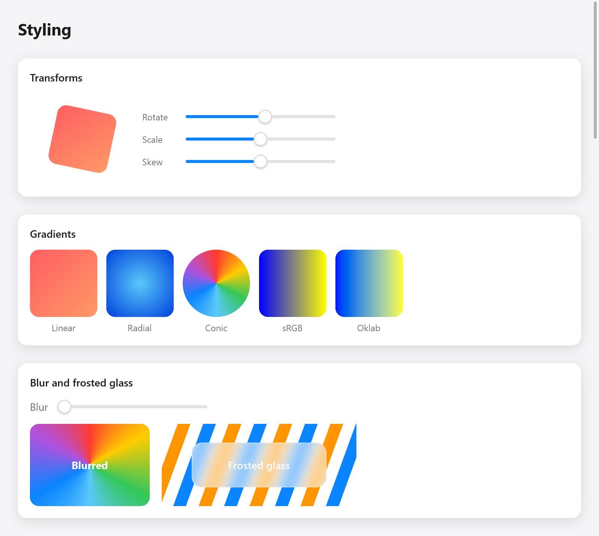

<a id="transforms-and-effects"></a>

# Biến đổi và hiệu ứng

Một hộp có thể được di chuyển, thu nhỏ, xoay và nghiêng khi nó được vẽ, tô màu chuyển sắc, làm mờ hoặc vẽ từ những gì bên dưới nó dưới dạng kính mờ. Tất cả đều là các trường của `ui.Style`, vì vậy bất kỳ hộp nào cũng có chúng và mọi bộ kết xuất (Metal, Direct3D 11, OpenGL, WebGL 2 và CPU) đều vẽ chúng giống nhau. Trang Kiểu dáng của thư viện hiển thị từng cái (`examples/gallery/motion.zig`).

<a id="transforms"></a>



*Phép xoay, gradient, blur và nền kính mờ do myzig render.*

## Chuyển đổi

`Style.transform` là `ui.Affine`, một bản đồ affine của mặt phẳng giống như CSS của `transform`. Nó hoạt động theo cách bố trí: chiếc hộp giữ nguyên vị trí và các anh chị em của nó không di chuyển. Nó di chuyển hộp và mọi thứ trong đó, khoảng `Style.transform_origin` (theo phân số của hộp; trung tâm của hộp theo mặc định, `.{ .x = 0, .y = 0 }` trên cùng bên trái).

```zig
_ = c.leaf(.{
    .width = .{ .px = 80 }, .height = .{ .px = 80 }, .radius = 12,
    .background = c.theme.accent,
    .transform = ui.Affine.rotation(s.rotate).then(.scaling(s.scale, s.scale)).then(.skewing(s.skew, 0)),
}, .none, null);
```

Các bản đồ:

| chức năng | CSS |
|---|---|
| `Affine.translation(x, y)` | `translate(x, y)` |
| `Affine.scaling(sx, sy)` | `scale(sx, sy)`; giá trị âm phản ánh |
| `Affine.rotation(degrees)` | `rotate()`, theo chiều kim đồng hồ trên màn hình |
| `Affine.skewing(x, y)` | `skew()`, tính bằng độ |
| `Affine{ .a, .b, .c, .d, .x, .y }` | `matrix(a, b, c, d, x, y)` |

Họ soạn theo thứ tự cuộc gọi: `a.then(b)` là `a`, sau đó `b` (`m.translate(x, y)`, `m.scale`, `m.rotate` và `m.skew` là viết tắt của `m.then(...)`). `m.about(point)` làm cho bản đồ hoạt động về một điểm chứ không phải gốc tọa độ, `m.apply(point)` ánh xạ một điểm, `m.inverse()` là bản đồ trở lại (null cho bản đồ làm phẳng mặt phẳng) và `m.bounds(rect)` hình chữ nhật nhỏ nhất chứa hình chữ nhật được ánh xạ. Lượt quý là chính xác.

Sự biến đổi của một đứa trẻ hành động trước tiên, sau đó là của cha mẹ nó. Một hộp được làm phẳng đến mức không có gì (tỷ lệ 0) không hiển thị gì và không có con trỏ.

<a id="the-pointer-follows-what-is-drawn"></a>

### Con trỏ đi theo những gì được vẽ

Các lần nhấp, di chuột và kéo sẽ đến hộp đã biến đổi nơi nó được vẽ chứ không phải nơi bố cục đặt nó: một nút xoay được nhấn bên trong đường viền đã xoay của nó. Kiểm tra lượt truy cập sẽ giữ lại hình chữ nhật riêng của từng hộp được chuyển đổi và bản đồ từ cửa sổ tới hộp đó (`src/ui/hit.zig`).

<a id="how-transforms-are-drawn"></a>

### Các phép biến đổi được vẽ như thế nào

Hầu hết các phép biến đổi chỉ di chuyển các hộp và chia tỷ lệ chúng giống nhau theo cả hai cách (`Affine.isSimilar`). Chúng được gấp lại vào hộp khi chúng được sơn, chúng vẫn là những chiếc hộp đơn giản với các góc tròn nên chúng không tốn kém gì. Những cái khác (xoay, nghiêng, tỷ lệ không đồng đều) giữ các hộp của chúng theo tọa độ riêng của cây con và cung cấp cho chúng phép biến đổi mà bộ kết xuất đọc để vẽ từng pixel từ vị trí của nó (`src/ui/paint_xf.zig`). Văn bản, đường viền, bóng và hình ảnh của hộp nghiêng cũng được vẽ nghiêng.

Biến đổi là cách tạo hoạt ảnh rẻ nhất: hoạt ảnh không thay đổi bố cục. Xem [Chuyển động](motion.md):

```zig
const s = ui.motion.to(c, "scale", if (hovered) 1.05 else 1, .snappy);
```

<a id="opacity-and-offset"></a>

## Độ mờ và độ lệch

`Style.opacity` làm mờ một hộp và nội dung của nó cùng nhau. `Style.offset` di chuyển một hộp sau bố cục mà không di chuyển các anh chị em của nó, như bản dịch vẫn làm, đồng thời đặt một hộp `absolute` bên trong hộp mẹ của nó.

<a id="gradients"></a>

## Độ dốc

`Style.gradient` trỏ tới `ui.Gradient`, được pha trộn trên hộp trên nền của nó, trong các góc tròn của nó, như `linear-gradient()`, `radial-gradient()` và `conic-gradient()` của CSS:

```zig
const sunset: ui.Gradient = .{
    .stops = &.{ .{ .color = .hex(0xff5e62), .at = 0 }, .{ .color = .hex(0xff9966), .at = 1 } },
    .angle = 135,
};
const ocean: ui.Gradient = .{ .kind = .radial, .stops = &.{
    .{ .color = .hex(0x5ac8fa), .at = 0 }, .{ .color = .hex(0x0040dd), .at = 1 },
} };

_ = c.leaf(.{ .width = .{ .px = 90 }, .height = .{ .px = 90 }, .radius = 12, .gradient = &sunset }, .none, null);
```

| lĩnh vực | ý nghĩa |
|---|---|
| `kind` | `.linear` (mặc định), `.radial` hoặc `.conic` |
| `stops` | `ui.Stop`s (`color`, `at` từ 0 đến 1), theo thứ tự, tối đa `Gradient.max_stops` (16) |
| `angle` | tuyến tính: độ theo chiều kim đồng hồ từ trên xuống; 180 (mặc định) từ trên xuống dưới, 90 từ trái sang phải |
| `start` | hình nón: nơi bắt đầu rẽ, tính bằng độ từ trên xuống (CSS's `from`) |
| `center` | xuyên tâm và hình nón: theo phân số của hộp |
| `radius` | radial: bán kính của điểm dừng cuối cùng tính theo điểm; null tới góc xa nhất |
| `oklab` | trộn trong Oklab, có điểm giữa giữ độ sáng thay vì sRGB (CSS's `in oklab`) |

Màu đầu tiên hiển thị trước điểm dừng đầu tiên, màu cuối cùng sau điểm dừng cuối cùng và hai điểm dừng ở cùng một nơi tạo nên một cạnh sắc nét. Độ dốc được giữ cho đến khi khung được vẽ: đặt nó thành hằng số hoặc đặt nó vào bộ nhớ của ứng dụng hoặc của khung (`c.alloc()`), không bao giờ nằm ​​trong ngăn xếp của view.

<a id="blur"></a>

## Làm mờ

`Style.blur` làm mờ hộp và các phần tử con của nó khi được vẽ, theo độ lệch chuẩn về điểm (CSS's `filter: blur()`). Chiếc hộp được vẽ thành một lớp riêng, lớp này được làm mờ và vẽ vào vị trí của nó, để nó trải rộng ra các cạnh của nó.

```zig
_ = c.open(.{ .width = .{ .px = 160 }, .height = .{ .px = 110 }, .radius = 12,
    .gradient = &wheel, .blur = s.blur, .align_items = .center, .justify = .center }, null);
ui.text(c, "Blurred", .{ .weight = .bold, .color = .white });
c.end();
```

<a id="backdrop-effects"></a>

## Hiệu ứng phông nền

`Style.effect` trỏ đến `ui.Effect`: hộp rút ra từ những gì được vẽ bên dưới nó, dưới nền của chính nó và các phần tử con. Chỉ với `blur`, đó là kính mờ (CSS's `backdrop-filter: blur()`):

```zig
const frost: ui.Effect = .{ .blur = 10 };

_ = c.open(.{ .width = .{ .px = 180 }, .height = .{ .px = 60 }, .radius = 14,
    .effect = &frost, .background = ui.Color.white.alpha(0.25),
    .border = ui.Color.white.alpha(0.5), .align_items = .center, .justify = .center }, null);
ui.text(c, "Frosted glass", .{ .weight = .semibold, .color = .white });
c.end();
```

Tại vị trí của hộp theo thứ tự sơn, mỗi bộ kết xuất sẽ đọc những gì nó đã vẽ xung quanh hình, làm mờ nó (xuống trung bình đối với các vết mờ lớn, sau đó là một Gaussian dọc theo hàng và cột, `src/ui/backdrop.zig`) và vẽ hộp từ nó trước khi vẽ tiếp.

<a id="effects-with-a-shader"></a>

### Hiệu ứng với shader

Một hiệu ứng cũng có thể tô màu khung của nó bằng một shader, một chức năng của pixel, hình dạng và phông nền mờ mà nó có thể lấy mẫu ở bất kỳ đâu (ống kính sẽ uốn cong những gì hiển thị qua nó). `ui.effect.Shader` có `name` (mỗi bộ kết xuất biên dịch một shader một lần), nguồn của nó cho GPU (`hlsl`, `glsl`, `msl`) và `cpu`, bản đối chiếu CPU của nó, phải vẽ các pixel giống nhau:

```zig
const Invert = struct {
    fn color(in: *const ui.effect.Input) [3]f32 {
        const b = in.sample(in.p[0], in.p[1]);
        return .{ 1 - b[0], 1 - b[1], 1 - b[2] };
    }
    const shader: ui.effect.Shader = .{ .name = "invert", .cpu = color };
};
const lens: ui.Effect = .{ .blur = 0, .shader = &Invert.shader };
```

Cặp song sinh nhận được `ui.effect.Input`: `p`, tâm của pixel trong các pixel của khung; `rect` (x, y, w, h) và `radius` của hình dạng tính bằng pixel; `params`, bốn tham số `[4]f32` của hiệu ứng (`Effect.params`); và `sample(x, y)`, phông nền mờ ở đó. Các nguồn GPU xác định `effect_color`, có các đối số giống nhau:

```
HLSL, GLSL:  float3 effect_color(EffectIn i)                        (vec3 in GLSL)
Metal:       float3 effect_color(EffectIn i, texture2d<float> backdrop)
```

với `backdrop_at(i, p)` (trong Metal `backdrop_at(i, backdrop, p)`) để lấy mẫu. Viết cùng một hiệu ứng ba lần và một lần nữa trong Zig là rất nhiều; [glass](../plugins/glass.md) là một hiệu ứng như vậy và hầu hết các ứng dụng đều viết shader một lần trong ZSL thay vào đó ([Shaders](shaders.md)), mà `ui.shaderEffect` biến thành một hiệu ứng.

`ui.gpu_testing` hiển thị view bằng bộ kết xuất GPU và CPU để kiểm tra plugin nhằm so sánh chúng.

<a id="clips"></a>

## Đoạn phim

`Style.clip` kẹp các phần tử con của hộp vào đó, theo các góc tròn của hộp. Một clip hộp cuộn (`scroll`) cũng vậy. Hộp đã chuyển đổi sẽ kẹp vào tọa độ riêng của nó, do đó nội dung của thẻ đã lật vẫn nằm trong thẻ đã lật.

<a id="see-also"></a>

## Xem thêm

- [Motion](motion.md): hoạt hình biến đổi, độ mờ và màu sắc.
- [Bản vẽ](drawing.md): đường dẫn, nét và độ dốc của hình dạng của riêng bạn.
- [Shaders](shaders.md): các hộp và hiệu ứng được vẽ bởi shader.
