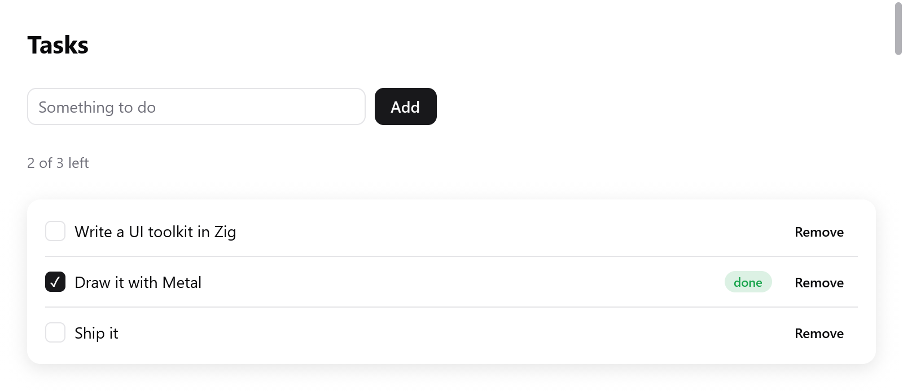

<a id="views"></a>

# View

View là một hàm biến state của app thành giao diện. Nó nhận con trỏ tới state của bạn và `*ui.Context` của cửa sổ. myzig gọi nó trên main thread để dựng một frame:

- sau input hoặc khi đổi kích thước;
- khi có thứ đang chạy animation;
- khi app yêu cầu.

<!-- demo: tasks height=371 -->



*Một view dựng từ state của app: danh sách việc cần làm, có việc đã xong và việc chưa xong.*

```zig
const Todos = struct {
    items: [32]Item = undefined,
    count: usize = 0,
    draft: ui.TextBuffer = .{},

    const Item = struct { title: [64]u8, len: usize, done: bool };

    fn view(s: *Todos, c: *ui.Context) void {
        ui.column(c, .{ .width = .fill, .height = .fill, .padding = .all(16), .gap = 8 });
        defer ui.end(c);
        for (s.items[0..s.count]) |*it| {
            ui.key(c, c.print("todo-{d}", .{@intFromPtr(it)}));
            _ = ui.checkbox(c, it.title[0..it.len], &it.done);
        }
        if (ui.textField(c, &s.draft, .{ .placeholder = "New to-do" }).submitted) {
            s.add(s.draft.text());
            s.draft.clear();
        }
    }

    fn add(s: *Todos, title: []const u8) void {
        if (s.count == s.items.len or title.len == 0) return;
        const n = @min(title.len, 64);
        s.items[s.count] = .{ .title = undefined, .len = n, .done = false };
        @memcpy(s.items[s.count].title[0..n], title[0..n]);
        s.count += 1;
    }
};
```

Tạo state một lần khi app khởi động, rồi đưa view của nó cho cửa sổ:

```zig
var state: Todos = .{};
_ = try app.newWindow(.{ .title = "To-dos", .content = .{ .view = .init(&state, Todos.view) } });
```

- `ui.View.init(&state, Todos.view)` ghép con trỏ với hàm. Hàm nào có dạng `fn (ptr: *T, c: *ui.Context) void` cũng được, nên view có thể là method hoặc hàm tự do.
- Một `ui.View` có thể đưa cho nhiều cửa sổ. Mỗi cửa sổ có context riêng, nên có focus, vị trí scroll và giá trị animation riêng.

Các ví dụ trong những hướng dẫn này là từng phần của một view như thế: `c` là `*ui.Context` của view và `s` là con trỏ tới state của bạn. Những giá trị cần tồn tại lâu, như [router](navigation.md), `ui.TextBuffer` hay struct state của một widget, là trường của state. Chúng không bao giờ là biến cục bộ của view, vì view chạy lại ở mỗi frame.

<a id="boxes-opened-and-ended"></a>

## Box, mở và đóng

```zig
ui.row(c, .{ .gap = 8 });
defer ui.end(c);
ui.text(c, "Name", .{});
ui.spacer(c);
_ = ui.button(c, "Edit", .{});
```

View là một cây box. Container mở một box, các lời gọi sau đó đi vào box này cho tới khi nó được đóng.

- `ui.column`, `ui.row`, `ui.card`, `ui.scroll` và `ui.pressable` đều mở một box mà `ui.end` đóng lại.
- `ui.div(c)` trả về một `ui.Div`, đóng bằng chính `end` của nó.
- Widget có phần tử con riêng cũng trả về một giá trị có method `end`: field của form, panel của popover, trang của tab.
- `defer` giữ mỗi lần đóng ngay cạnh lần mở. Với một box ở giữa hàm, dùng một block `{ ... }` có `defer` bên trong để giới hạn phạm vi.

<a id="interactions-and-the-second-build"></a>

## Tương tác và lần dựng thứ hai

Widget trả lời dựa trên layout của frame trước. Khi con trỏ nhấn xuống, myzig hit-test các box theo layout gần nhất. Vì vậy `ui.button(...).clicked` là true ngay trong lần dựng xử lý cú bấm, trước khi frame mới được layout.

Widget nào có tương tác làm đổi state của app thì đặt `c.changed`:

1. Cuối lần dựng, nếu `c.changed` được đặt, myzig dựng lại frame. Các cạnh của input, tức cú bấm và phím, đã được dùng.
2. Chỉ sau đó nó mới layout và vẽ frame.
3. Nên màn hình luôn hiển thị state sau sự kiện.

`c.stats.passes` đếm số lần dựng của frame vừa rồi.

Code của bạn đổi state để đáp lại input thì được lần dựng thứ hai miễn phí, như `clicked` của một `ui.Div` hay một shortcut. Nếu bạn tự đọc input và đổi state, hãy đặt `c.changed = true`.

<a id="ids-and-keys"></a>

## Id và key

Mỗi box có một id, tạo từ id của phần tử cha và vị trí của nó giữa các box anh em. Focus, hover, vị trí scroll, giá trị animation và con trỏ soạn thảo của text field được giữ theo id giữa các frame, nên id phải ổn định.

```zig
for (s.files) |f| {
    ui.key(c, f.path);
    s.fileRow(c, f);
}
```

Gắn key cho từng mục khi có box xuất hiện và biến mất trước các box khác, như một danh sách bị lọc, sắp xếp hay chỉnh sửa. `ui.key(c, k)` đặt tên cho box kế tiếp, và id của nó được tạo từ key thay vì vị trí. Key là chuỗi: dùng thứ định danh được mục đó, không phải chỉ số của nó.

```zig
for (s.todos.items) |*todo| {
    c.keyed(todo);
    todoRow(c, todo);
}
```

`c.keyed(value)` (hoặc `ui.keyed(c, value)`) gắn key cho box kế tiếp bằng bất kỳ giá trị nào Zig so sánh được, không cần định dạng thành chuỗi:

- Hai giá trị khác nhau khi `std.meta.eql` phân biệt được chúng. Giá trị khác kiểu thì khác nhau.
- Con trỏ là key của đối tượng nó trỏ tới, dù đối tượng chứa gì. Nên con trỏ của một mục dùng làm key tốt như một id.
- Số nguyên, enum, hay struct gồm những thứ đó làm key theo giá trị.

**Box chỉ thỉnh thoảng hiện.** Một box đơn lẻ chỉ thỉnh thoảng hiện ở trước một nút, như dấu hiện khi hover, sẽ làm dịch id của nút. Một cú bấm xảy ra giữa chừng sẽ bị mất.

- Gắn key cho nút, hoặc luôn dựng box rồi ẩn nó bằng giao diện ([custom widget](custom-widgets.md#a-box-that-comes-or-goes-moves-the-ids-after-it)).
- Bản build debug ghi cảnh báo khi một cú bấm bị mất như vậy.
- Nó cũng cảnh báo khi id của một box đang scroll thay đổi khiến vị trí scroll về đầu hoặc nhảy.

`c.peekId(null)` trả về id mà box kế tiếp sẽ nhận, cho widget cần biết trước khi mở box.

<a id="the-context"></a>

## Context

`ui.Context` thuộc về cửa sổ, và sống lâu bằng cửa sổ. Các trường view đọc:

| Trường | Là gì |
|---|---|
| `theme` | màu và font của frame ([styling](styling.md)) |
| `size` | kích thước nội dung cửa sổ, tính bằng điểm |
| `scale` | số pixel mỗi điểm |
| `dt` | số giây từ frame trước |
| `time` | số giây từ frame đầu tiên, là đồng hồ cho animation mà view tự điều khiển |
| `frame` | số thứ tự của frame |
| `input` | input của sự kiện này: con trỏ, nút chuột, phím, chữ, con lăn |
| `stats` | chi phí của frame vừa rồi (`ui.FrameStats`) |

Và các trường view đặt:

| Trường hoặc method | Tác dụng |
|---|---|
| `changed = true` | dựng lại frame trước khi vẽ |
| `c.animationFrame()` | xin thêm một frame ở lần refresh kế tiếp |
| `c.frameIn(seconds)` | xin một frame trong vòng `seconds` (giây kế tiếp của đồng hồ) |
| `wants_moves = true` | mỗi lần con trỏ di chuyển đều vẽ một frame (đường chữ thập của đồ thị); bị xóa mỗi frame |
| `wants_keys = true` | nhấn và nhả phím đến dưới dạng `input.key_down` / `input.key_up` (game) |
| `wants_wheel = true` | con lăn đến dưới dạng `input.scroll` ở chỗ không có gì scroll |
| `cursor = .resize_left_right` | hình dạng con trỏ (`ui.Cursor`) |
| `title_bar_height` | phần phía trên dùng để kéo cửa sổ khi thanh tiêu đề bị ẩn |
| `c.setZoom(z)` | phóng mọi chữ theo `z` (0.5 đến 3), như ⌘= và ⌘- của một app |

`c.print(fmt, args)` định dạng vào bộ nhớ của frame, và `c.alloc()` trả về chính allocator đó. Cả hai được giải phóng khi frame kế tiếp bắt đầu.

<a id="shortcuts"></a>

## Shortcut

`c.shortcut` nhận một tổ hợp phím khi sự kiện này đúng là tổ hợp đó:

```zig
if (c.shortcut(.{ .key = 'k', .cmd = true })) s.clear();
if (c.shortcut(.{ .key = ui.Shortcut.escape })) s.closePanel();
```

- Command nghĩa là Control khi không phải macOS, nên một shortcut dùng được cho mọi nền tảng.
- Ký tự viết thường. Các phím khác là hằng như `ui.Shortcut.up`, `.enter` và `.tab`.
- Shortcut mà view đã nhận thì không đi tiếp trong frame (`c.shortcut_taken` được đặt).
- `ui.keys.label` viết một tổ hợp phím cho `ui.kbd`, theo cách của nền tảng. Tổ hợp được cho lúc compile bằng ký hiệu của Mac: `"⌘P"` thành `"Ctrl+P"` trên Linux và Windows.

Với shortcut có tên, mục menu và mục trong command palette, xem [`ui.Actions`](navigation.md).

<a id="focus-and-the-keyboard"></a>

## Focus và bàn phím

- Control nhận focus bàn phím khi được bấm.
- Tab và Shift-Tab chuyển focus qua các control theo thứ tự chúng được dựng.
- Control được focus bằng bàn phím vẽ một vòng màu accent (`c.focus_visible`).
- Enter và Space bấm nút, checkbox hoặc switch đang có focus. Các phím mũi tên di chuyển slider, nhóm radio và rating.

<a id="changing-the-state-from-outside"></a>

## Đổi state từ bên ngoài

View đọc state của bạn trên main thread. Việc làm ở nơi khác, như timer, output của một process hay phản hồi mạng, đổi state trên main thread. Sau đó nó xin cửa sổ một frame bằng `Window.redraw`:

```zig
fn tick(ctx: ?*anyopaque) callconv(.c) void {
    const s: *State = @ptrCast(@alignCast(ctx));
    s.seconds += 1;
    s.window.redraw();
    myzig.App.after(1000, ctx, tick);
}

// Trong main, sau khi tạo cửa sổ:
myzig.App.after(1000, &state, tick);
```

- `App.after` chạy một hàm trên main thread sau một khoảng trễ.
- Từ thread khác, chuyển việc sang main thread trước. [Plugin mainthread](../plugins/mainthread.md) đẩy việc vào hàng đợi riêng của main thread trên mọi nền tảng.
- Trong view, nên dùng `c.frameIn(seconds)` cho thứ đổi theo lịch (đồng hồ, spinner). Nó chỉ xin đúng frame đó, không vẽ mọi lần refresh ở giữa.

<a id="text-and-input-that-a-view-takes-itself"></a>

## Chữ và input mà view tự xử lý

Một widget tự sửa chữ theo cách riêng:

- đọc `c.input.ops`, các thao tác chữ của sự kiện (`ui.TextOp`): chữ được chèn, chuỗi đang soạn của bộ gõ, các lệnh như `.delete_backward` hay `.move_word_left`;
- đặt `c.focused_text` để báo cho bộ gõ biết con trỏ soạn thảo đang ở đâu.

Xem [nhập chữ](text-input.md) và [custom widget](custom-widgets.md).
