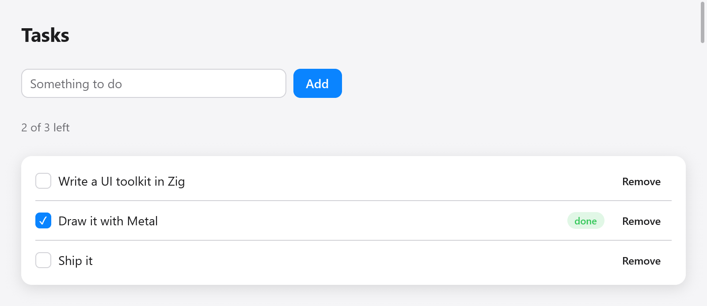

<a id="views"></a>

# View

View là một chức năng từ trạng thái ứng dụng của bạn đến giao diện của nó. myzig gọi nó trên luồng chính để tạo khung sau khi nhập, thay đổi kích thước, trong khi nội dung nào đó hoạt ảnh và khi ứng dụng yêu cầu. Nó đưa một con trỏ tới trạng thái của bạn và `*ui.Context` của cửa sổ:



*View dựng từ trạng thái ứng dụng: danh sách công việc đã xong và đang chờ.*

```zig
const Todos = struct {
    items: [32]Item = undefined,
    count: usize = 0,
    draft: ui.TextBuffer = .{},

    const Item = struct { title: [64]u8, len: usize, done: bool };

    fn view(s: *Todos, c: *ui.Context) void {
        ui.column(c, .{ .width = .fill, .height = .fill, .padding = .all(16), .gap = 8 });
        defer ui.end(c);
        for (s.items[0..s.count]) |*it| {
            ui.key(c, c.print("todo-{d}", .{@intFromPtr(it)}));
            _ = ui.checkbox(c, it.title[0..it.len], &it.done);
        }
        if (ui.textField(c, &s.draft, .{ .placeholder = "New to-do" }).submitted) {
            s.add(s.draft.text());
            s.draft.clear();
        }
    }

    fn add(s: *Todos, title: []const u8) void {
        if (s.count == s.items.len or title.len == 0) return;
        const n = @min(title.len, 64);
        s.items[s.count] = .{ .title = undefined, .len = n, .done = false };
        @memcpy(s.items[s.count].title[0..n], title[0..n]);
        s.count += 1;
    }
};
```

Tạo trạng thái một lần khi ứng dụng khởi động và đưa view của nó ra cửa sổ:

```zig
var state: Todos = .{};
_ = try app.newWindow(.{ .title = "To-dos", .content = .{ .view = .init(&state, Todos.view) } });
```

`ui.View.init(&state, Todos.view)` ghép con trỏ với hàm: mọi `fn (ptr: *T, c: *ui.Context) void` đều hoạt động, vì vậy một khung nhìn có thể là một phương thức hoặc một hàm tự do. `ui.View` tương tự có thể được cấp cho một số cửa sổ; mỗi cửa sổ có ngữ cảnh riêng, do đó tiêu điểm, độ lệch cuộn và giá trị hoạt ảnh riêng của nó.

Các ví dụ trong các hướng dẫn này là các phần của một view như vậy: `c` là `*ui.Context` của view và `s` con trỏ tới trạng thái của bạn. Các giá trị cuối cùng, chẳng hạn như [bộ định tuyến](navigation.md), `ui.TextBuffer` hoặc cấu trúc trạng thái của widget, là các trường của trạng thái, không bao giờ là cục bộ của view, chạy cho mọi frame.

<a id="boxes-opened-and-ended"></a>

## Hộp, mở và kết thúc

Một khung nhìn là một cây hộp. Các thùng chứa mở một hộp mà các lệnh gọi tiếp theo sẽ đi vào cho đến khi nó kết thúc:

```zig
ui.row(c, .{ .gap = 8 });
defer ui.end(c);
ui.text(c, "Name", .{});
ui.spacer(c);
_ = ui.button(c, "Edit", .{});
```

`ui.column`, `ui.row`, `ui.card`, `ui.scroll` và `ui.pressable` mỗi người mở một hộp có `ui.end` đóng lại; `ui.div(c)` trả về `ui.Div` có `end` đóng nó. Các widget con chứa các widget con của riêng chúng (trường của biểu mẫu, bảng điều khiển của cửa sổ bật lên, trang của tab) cũng trả về một giá trị bằng phương thức `end`. `defer` giữ cho mỗi đầu luôn mở; đối với một hộp ở giữa một hàm, một khối `{ ... }` có `defer` bên trong sẽ bao quanh nó.

<a id="interactions-and-the-second-build"></a>

## Tương tác và bản dựng thứ hai

Widget phản hồi dựa trên bố cục của frame trước. Khi nhấn con trỏ, myzig kiểm tra điểm nhấn trên các box theo bố cục gần nhất. Vì vậy, `ui.button(...).clicked` có giá trị true trong lần dựng xử lý thao tác nhấn, trước khi bố cục của frame mới được tính.

Một widget có tương tác thay đổi trạng thái của ứng dụng sẽ đặt `c.changed`. Khi kết thúc quá trình xây dựng, nếu `c.changed` được đặt, myzig sẽ tạo lại khung (với các cạnh của đầu vào, cú nhấp chuột và phím, đã được sử dụng) và chỉ sau đó mới bố trí và vẽ nó. Do đó, màn hình luôn hiển thị trạng thái sau sự kiện. `c.stats.passes` đếm số bản dựng của khung cuối cùng.

Mã của riêng bạn thay đổi trạng thái để phản hồi với đầu vào (`ui.Div`'s `clicked`, một phím tắt) nhận được bản dựng thứ hai miễn phí; nếu bạn tự đọc dữ liệu đầu vào và thay đổi trạng thái, hãy đặt `c.changed = true`.

<a id="ids-and-keys"></a>

## Id và khóa

Mỗi hộp có một id, được tạo từ id cha và vị trí của nó giữa các hộp anh chị em của nó. Tiêu điểm, di chuột, độ lệch cuộn, giá trị hoạt ảnh và dấu mũ trường văn bản được giữ bằng id giữa các khung, vì vậy id phải ổn định.

Khi các hộp đến và đi trước các hộp khác (danh sách được lọc, sắp xếp hoặc chỉnh sửa), hãy đặt cho mỗi mục một khóa: `ui.key(c, k)` đặt tên cho hộp tiếp theo và id của nó sau đó được tạo từ khóa thay vì vị trí của nó. Chìa khóa là chuỗi; sử dụng cái gì đó để xác định mục, không phải chỉ mục của nó:

```zig
for (s.files) |f| {
    ui.key(c, f.path);
    s.fileRow(c, f);
}
```

`c.keyed(value)` (hoặc `ui.keyed(c, value)`) khóa hộp tiếp theo theo bất kỳ giá trị nào Zig so sánh, vì `std.meta.eql` phân biệt hai giá trị này, với các giá trị thuộc các loại khác nhau: một con trỏ khóa đối tượng mà nó trỏ tới, bất kể đối tượng đó giữ gì, do đó, con trỏ của một mục đóng vai trò là khóa của nó giống như id; một số nguyên, một enum hoặc một cấu trúc của các khóa theo giá trị của nó mà không cần định dạng chuỗi:

```zig
for (s.todos.items) |*todo| {
    c.keyed(todo);
    todoRow(c, todo);
}
```

Điều tương tự cũng xảy ra với một hộp duy nhất đôi khi chỉ hiển thị (một dấu khi di chuột) trước một nút: nó di chuyển id của nút và lần nhấn ở giữa sẽ bị mất. Nhấn nút hoặc luôn tạo hộp và ẩn nó bằng giao diện của nó ([widget tùy chỉnh](custom-widgets.md#a-box-that-comes-or-goes-moves-the-ids-after-it)). Bản dựng gỡ lỗi sẽ ghi lại cảnh báo khi nhấn bị mất và khi id của hộp cuộn thay đổi để phần bù của nó bắt đầu lại hoặc nhảy.

`c.peekId(null)` trả về id mà hộp tiếp theo sẽ nhận được, dành cho các vật dụng cần nó trước khi chúng mở hộp.

<a id="the-context"></a>

## Bối cảnh

`ui.Context` là của cửa sổ và tồn tại chừng nào nó còn tồn tại. Các khung nhìn trường có nội dung:

| lĩnh vực | nó là gì |
|---|---|
| `theme` | màu sắc và phông chữ của khung ([kiểu dáng](styling.md)) |
| `size` | kích thước nội dung của cửa sổ, tính bằng điểm |
| `scale` | pixel mỗi điểm |
| `dt` | giây kể từ frame trước đó |
| `time` | giây kể từ frame đầu tiên, đồng hồ hoạt ảnh của view sẽ tự điều khiển |
| `frame` | số của khung |
| `input` | đầu vào của sự kiện này: con trỏ, nút, phím, văn bản, bánh xe |
| `stats` | frame cuối cùng có giá bao nhiêu (`ui.FrameStats`) |

Và những lượt xem được đặt:

| trường hoặc phương thức | nó làm gì |
|---|---|
| `changed = true` | xây dựng lại khung trước khi vẽ nó |
| `c.animationFrame()` | yêu cầu frame khác ở lần làm mới tiếp theo |
| `c.frameIn(seconds)` | yêu cầu khung trong `seconds` (giây tiếp theo của đồng hồ) |
| `wants_moves = true` | mỗi lần di chuyển con trỏ sẽ vẽ một khung (hình chữ thập của đồ thị); xóa từng frame |
| `wants_keys = true` | các lần nhấn và nhả phím có dạng `input.key_down` / `input.key_up` (trò chơi) |
| `wants_wheel = true` | bánh xe xuất hiện dưới dạng `input.scroll` nơi không có gì cuộn |
| `cursor = .resize_left_right` | hình dạng của con trỏ (`ui.Cursor`) |
| `title_bar_height` | phần trên cùng di chuyển một cửa sổ có thanh tiêu đề ẩn bao nhiêu |
| `c.setZoom(z)` | chia tỷ lệ mọi văn bản theo `z` (0,5 đến 3), dưới dạng ⌘= và ⌘- của ứng dụng |

`c.print(fmt, args)` định dạng vào bộ nhớ của khung và `c.alloc()` cung cấp chính bộ cấp phát đó; cả hai đều được giải phóng khi khung tiếp theo bắt đầu.

<a id="shortcuts"></a>

## Phím tắt

`c.shortcut` lấy tổ hợp phím khi diễn ra sự kiện này:

```zig
if (c.shortcut(.{ .key = 'k', .cmd = true })) s.clear();
if (c.shortcut(.{ .key = ui.Shortcut.escape })) s.closePanel();
```

Lệnh có nghĩa là Tắt macOS, do đó, một phím tắt sẽ phục vụ mọi nền tảng. Ký tự là chữ thường; các khóa khác là các hằng số như `ui.Shortcut.up`, `.enter` và `.tab`. Một phím tắt mà view sẽ không đi xa hơn trong khung (`c.shortcut_taken` được đặt). `ui.keys.label` viết một tổ hợp, được đưa ra tại thời điểm biên dịch với các ký hiệu của Mac, giống như nền tảng thực hiện (`"⌘P"` trở thành `"Ctrl+P"` trên Linux và Windows), cho `ui.kbd`. Để biết các phím tắt có tên, mục menu và mục nhập bảng màu, hãy xem [`ui.Actions`](navigation.md).

<a id="focus-and-the-keyboard"></a>

## Tập trung và bàn phím

Các điều khiển lấy tiêu điểm bàn phím khi được nhấn, đồng thời Tab và Shift-Tab di chuyển tiêu điểm qua chúng theo thứ tự chúng được tạo. Điều khiển được tập trung từ bàn phím sẽ vẽ một vòng có màu nhấn (`c.focus_visible`). Enter và Space nhấp vào nút, hộp kiểm hoặc công tắc có tiêu điểm; các mũi tên di chuyển thanh trượt, nhóm radio và xếp hạng.

<a id="changing-the-state-from-outside"></a>

## Thay đổi trạng thái từ bên ngoài

View đọc trạng thái của bạn trên luồng chính. Công việc được thực hiện ở nơi khác (bộ hẹn giờ, đầu ra của quy trình, phản hồi mạng) sẽ thay đổi trạng thái trên luồng chính và sau đó yêu cầu cửa sổ cung cấp khung có `Window.redraw`:

```zig
fn tick(ctx: ?*anyopaque) callconv(.c) void {
    const s: *State = @ptrCast(@alignCast(ctx));
    s.seconds += 1;
    s.window.redraw();
    myzig.App.after(1000, ctx, tick);
}

// In main, after the window is made:
myzig.App.after(1000, &state, tick);
```

`App.after` chạy một chức năng trên luồng chính sau một khoảng thời gian trễ. Từ các luồng khác, trước tiên hãy giao công việc cho luồng chính: [mainthread](../plugins/mainthread.md) đăng công việc lên hàng đợi riêng của luồng chính trên mọi nền tảng. Trong view, hãy ưu tiên `c.frameIn(seconds)` cho những thay đổi trong lịch trình (đồng hồ, vòng quay): nó chỉ yêu cầu khung đó mà không vẽ mỗi lần làm mới ở giữa.

<a id="text-and-input-that-a-view-takes-itself"></a>

## Văn bản và dữ liệu đầu vào mà view tự thực hiện

Một widget chỉnh sửa văn bản theo cách riêng của nó sẽ đọc `c.input.ops`, các thao tác văn bản của sự kiện (`ui.TextOp`: văn bản được chèn, thành phần của phương thức nhập, các lệnh như `.delete_backward` hoặc `.move_word_left`) và đặt `c.focused_text` để cho phương thức nhập biết vị trí của dấu mũ. Xem [nhập văn bản](text-input.md) và [widget tùy chỉnh](custom-widgets.md).
